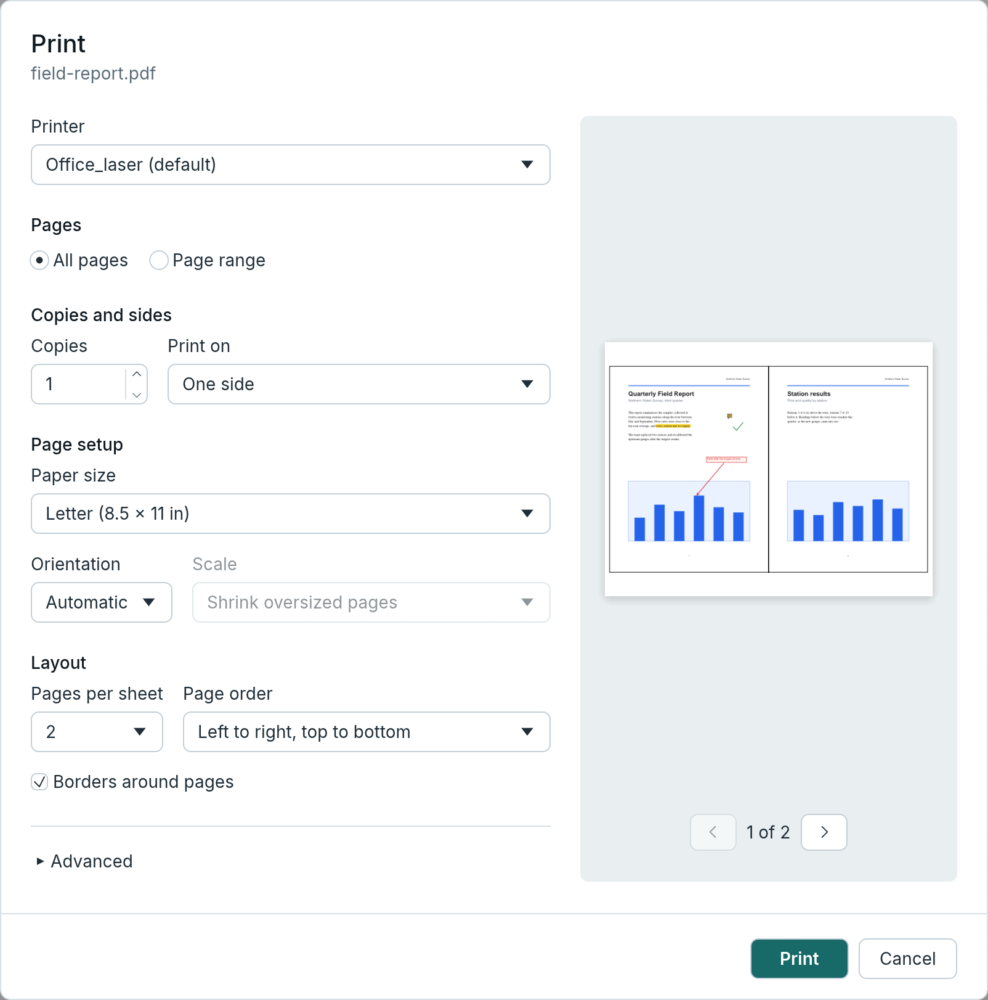

[User guide](README.md) › Everyday tasks

# Export and printing

Print a document, save its pages as pictures, or save its text.

## Printing

1. Press Ctrl+P (⌘P on a Mac), or **Print** at the right of the commands row (or ☰ > Print…).
2. Choose the printer, the pages (**All pages**, or **Page range**, which starts as the selected pages when there
   are any), the copies, and **Print on** one side or both sides (flipped on the long or the short edge).
3. Under **Page setup**, choose the paper, the orientation and the scale, and under **Layout** how many pages go
   on each sheet (below); check the preview.
4. Press **Print**.



**Print preview** in the ☰ menu opens the same dialog, as in Word: Ctrl+F2 (⌘F2 on a Mac). On Linux it is also
Ctrl+Shift+O, as in LibreOffice, since some desktops (KDE's) keep Ctrl+F2 for themselves.

The dialog opens at once. The first time, it says it is looking for printers until the system has listed them:
on Linux and macOS the printers set up on this computer come at once, and printers found on the network are added
about a second later. After that it opens with the printers and paper sizes already found, ready to print, while
it looks again in the background and adds any printer that has appeared since. The printer you last printed to
is chosen, when it is there; otherwise the system's default. If the printing service doesn't answer within 10
seconds or can't list the printers, the dialog says why; with no printers set up, it says so. Either way, **Try
again** looks once more (after adding a printer in the system's settings, say).

### Page setup

- **Paper size:** the sizes the printer takes, as the system names them ("Letter (8.5 × 11 in)", "A4 (210 ×
  297 mm)"). LimarePDF asks the printing service for them when you choose the printer; meanwhile the dialog says
  it is finding them and Print is greyed. If they can't be found, the dialog says why, and **Try again** asks
  once more. The paper chosen at first is the one you last printed on with that printer, else the printer's own
  default.
- **Orientation:** **Automatic** (the usual choice) turns each page wider than it is tall a quarter turn onto the
  sheet, as printers turn landscape pages; **Portrait** prints every page upright; **Landscape** turns every
  page.
- **Scale:** **Shrink oversized pages** (the usual choice, as in Acrobat) prints each page at its own size,
  shrunk to the printable area only when it is larger; **Fit to printable area** enlarges or shrinks each page to
  fill it; **Actual size** prints each page at its own size; **Custom** prints at a percentage from 1 to 400%,
  set beside it.

The printer, the paper for each printer, the orientation and the scale are remembered for next time when you
print, as Acrobat keeps the last scaling. Copies and the scale's percentage are [number
boxes](gui.md#number-boxes): type a number, or step it with ▲ and ▼.

### Layout

- **Pages per sheet:** 1 (the usual choice), 2, 4, 6, 9 or 16 pages on each sheet of paper, to save paper or
  print handouts. Each page is made as large as fits in its place on the sheet, larger or smaller, so **Scale**
  is greyed meanwhile. A page whose shape is the other way round from its place's (a wide page where the places
  are tall) is turned in it to fit larger.
- **Page order:** how the pages fill a sheet: **Left to right, top to bottom** (the usual choice, as you read),
  **Right to left, top to bottom**, **Top to bottom, left to right** or **Top to bottom, right to left**.
- **Borders around pages:** a thin line around each page on the sheet.

Page order and Borders around pages are greyed with one page a sheet. With **Orientation** on Automatic, each
sheet is turned the way its pages come out largest: two upright pages a sheet print side by side on a sheet held
sideways, four upright pages in two rows on an upright sheet. Portrait and Landscape say which way the sheet is
held, and the pages go on it in rows as it is held. A last sheet with fewer pages leaves the rest of it blank.
Pages per sheet, the order and the borders are remembered for next time when you print.

Printing selected text, the choice of how it is laid out (as it looks, or plain text) is at the top of the same
group.

### The preview

Beside the settings (under them in a narrow window), the preview shows each sheet of paper as it will print: the
pages asked for (or the selected text, in the layout chosen), on the paper chosen, turned and scaled as chosen,
with the comments and form fields that print. It is drawn from the same sheets that are sent to the printer, so
where each page goes, its size and its turn are as they will be on paper (on Linux and macOS the printing service
draws the pages' content itself, which can differ slightly, as said below). A sheet with its page turned onto it,
or with pages side by side on a sheet held sideways, is shown held sideways, so the pages read the right way up.
With several pages a sheet, the preview shows each sheet with its pages and counts the sheets, not the pages.
**‹** and **›** go to the sheet before and after, with the sheet's number between them ("1 of 12"). The preview
follows each change at once, the page range too.

Under the preview, a line says when the printer doesn't say how near the edges it can print (anything near them
may be cut off), and which pages reach past the printable area at the scale chosen (their edges won't print).

### How it is printed

Printing runs in the background. A page range LimarePDF can't read is reported under it, with what you typed kept
(the preview stays on the pages last asked for). **Print as image** is under Advanced (see below). To print only
some text, select it and right-click > Print selected text… (see
[Reading and finding](reading-and-finding.md#print-or-save-just-the-selection)).

LimarePDF lays out what is printed itself, the same way on every system. Each page goes on a sheet of the paper
chosen, centred, as the orientation and scale say, or with several pages a sheet in its place on the sheet. When
the printer doesn't say how near the edges it can print, a quarter of an inch is kept clear. Comments and form
fields meant for printing are drawn in and the others left out; pop-up notes aren't printed. The open document
isn't changed.

Not yet available: booklets, colour and printer-specific options.

**Linux and macOS** print through CUPS. LimarePDF asks CUPS for the printer's paper sizes and margins, and sends
the laid-out pages to `lp` as an unencrypted PDF that names its paper, with CUPS's own scaling turned off so the
pages aren't shrunk a second time. CUPS draws them with its own engine, so a printout can differ from LimarePDF's
screen; "Print as image" (`--as-image`) sends them drawn by LimarePDF at 300 dpi instead. When LimarePDF can't find
out which paper the printer takes, it sends nothing and says why. A job that CUPS doesn't take within 2 minutes, or
doesn't confirm within 2 minutes after taking it, is stopped, with a message saying it may have been sent: check
the printer's queue before printing again.

**Windows** prints through the print spooler, on the paper chosen, which LimarePDF sets in the printer's settings
for the job. LimarePDF draws each sheet at the printer's resolution, at most 600 dpi and at most 268 million
pixels (an A0 sheet is drawn at about 415 dpi, which the printer scales up), and sends the part the printer can
print on. When the spooler takes no step for 2 minutes (a printer that doesn't answer, say), LimarePDF stops waiting and says so, and other
background work (Append PDFs, OCR, exports) can go ahead. The job itself can't be stopped on Windows and may still
print once the printer is ready: check the printer's queue before printing again.

A filled form field with no drawing of its own is drawn by LimarePDF when printed, however the pages are sent (as a
PDF, as images, or on Windows). On every system, a filled field meant for printing that has no drawing of its own,
and whose text LimarePDF can't draw (Hebrew or Arabic, say, or characters no installed font has, filled in by an
app that left the drawing to the reader), would come out empty. Print names those fields and asks first (Print anyway);
`limarepdf-cli print` names them and sends nothing (it has no way to print anyway: open the file in the app for
that).

On the command line: `limarepdf-cli printers` (with `--paper`, each printer's paper sizes) and `limarepdf-cli print`.

### Paper, orientation and scale on the command line

```
limarepdf-cli print report.pdf --paper A4 --orientation landscape --scale fit
```

- `--paper`: one of the printer's sizes as `limarepdf-cli printers --paper` lists them, by name with or without
  its size ("A4", "Letter (8.5 × 11 in)"), in capitals or not; sizes sharing a name, such as index cards, are told
  apart by their size. Without it, the printer's default. When CUPS can't list the printer's sizes, a standard
  size by name (A4, Letter, Legal and so on) is sent as it is.
- `--orientation`: `auto` (the default) turns each page wider than it is tall; `portrait` prints every page
  upright; `landscape` turns every page.
- `--scale`: `shrink` (the default) shrinks pages larger than the printable area; `fit` enlarges or shrinks each
  page to fill it; `actual` prints each page at its own size; or a percentage from 1 to 400 (`--scale 150` or
  `150%`). A page reaching past the printable area at `actual` or a percentage is printed centred and loses its
  edges, and the command warns first, naming the pages.
- `--pages-per-sheet`: 1 (the default), 2, 4, 6, 9 or 16 pages on each sheet, each fitted to its place, as in the
  app's [Layout](#layout); `--scale` can't be given with more than one. `--page-order`: `across` (the default:
  left to right, top to bottom), `across-from-right` (right to left, top to bottom), `down` (top to bottom, left
  to right) or `down-from-right` (top to bottom, right to left). `--borders` draws a thin line around each page.
  The order and borders need more than one page a sheet: alone, the command says so and prints nothing.

```
limarepdf-cli print slides.pdf --pages-per-sheet 4 --page-order down --borders
```

## Pages as images

1. Select the pages to export (or none, for every page), and choose ☰ > **Export pages as images…**, which opens
   **Export pages as images** in the inspector.
2. Check the pages, and choose **PNG** or **JPEG** (and the JPEG quality), and the resolution.
3. Press **Choose folder…** and pick where the files go.
4. Close the tool with the × at the top of the inspector.

Pages are saved one file per page, named after the document and the page number (`report-001.png`, …), at 36 to
1152 dpi. Exporting runs in the background and asks before replacing files. The resolution is stored in each file,
so the images import back at the page's size. LimarePDF draws the pages with its own renderer.

A page image can have at most 268 million pixels (A3 at 1152 dpi; a 4 × 3 foot poster at about 390 dpi); a larger
one is an error that names the page, and a lower resolution works. Large page images are drawn in bands, which
bounds the memory a complex page takes but makes some pages slower to export
([details](rendering.md#large-drawings)).

On the command line: `limarepdf-cli render --format png|jpeg`. Like the app, it draws a filled form field that has
no drawing of its own (some apps leave drawing it to the reader). A field whose text LimarePDF can't draw
(Hebrew or Arabic, say, or characters no installed font has) comes out empty: the images are still written, with a warning naming
those fields.

## Text

☰ > **Export text…** (or the command palette, Ctrl+K) writes every page's text to a `.txt` file, with pages
separated by form feeds, as pdftotext does. On the command line, `limarepdf-cli text` prints it. How the text is
read, and its limits: [How text is read](reading-and-finding.md#how-text-is-read).

Word, Excel and CSV export are not available.

## How this was tested

Export and printing have automated tests. On paper, printing was tried on Linux, with an HP laser printer through
CUPS, before LimarePDF laid out the pages itself: pages, mixed A4 and Letter pages, a turned page, comments and
filled form fields printed correctly. The pages as LimarePDF now lays them out haven't been printed on paper yet,
so the preview hasn't been compared with a printout.
On Windows only the print dialog has been tried, and nothing has been printed on macOS. The full record is in
[Testing](developer/testing.md#export-and-printing).

---

[← Scans and OCR](scanning-and-ocr.md) · [User guide](README.md) · [Password protection →](security.md)
