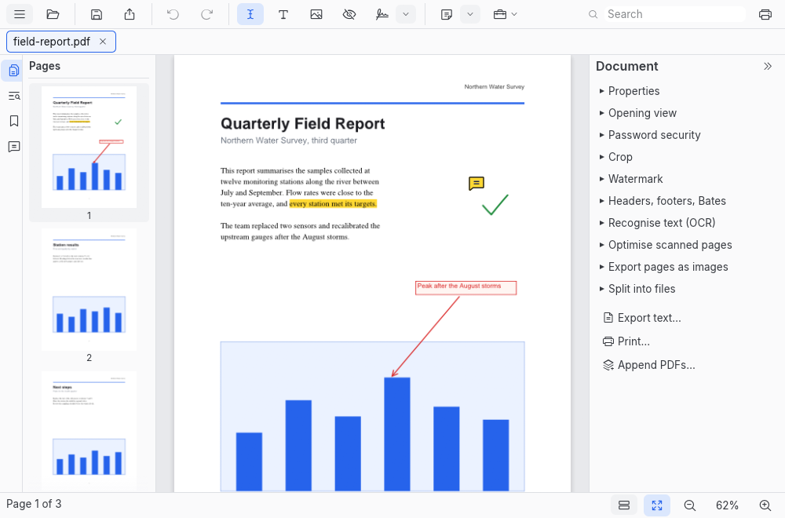

[User guide](README.md) › Getting started

# Features

LimarePDF is a complete PDF editor that works entirely on your computer. Open a document and change it the way
you would in a word processor: fix a typo where it stands, fill in a form, sign it, stamp it, black out what
shouldn't be seen, then print it or send it on. There is no account to make, no subscription to pay and nothing
uploaded: your documents never leave your computer. It runs on Linux, Windows and macOS, and it is free and open
source.

## What you can do

- **Read comfortably:** open documents in tabs, scroll and zoom smoothly, follow bookmarks and links, and switch
  pages to dark, sepia or high-contrast colours for easier reading.
- **Find anything:** search a whole document as you type, with every match highlighted on the page.
- **Edit text where it is:** double-click a line to change it, and make words bold, italic, or another font, size
  or colour.
- **Add and arrange content:** add text, pictures and shapes, and move, resize, restyle or delete what is already
  on the page.
- **Comment and mark up:** highlights, notes, text boxes, shapes, arrows, freehand drawing and replies.
- **Organise pages:** drag thumbnails to reorder pages; rotate, insert, delete and extract them; merge files into
  one or split one into several.
- **Fill in forms:** text fields, checkboxes, radio buttons and lists, ready to save, print or send.
- **Fill and sign any document:** add your signature (drawn, typed or from a picture), your initials, the date and
  ticks, even where the document has no form fields.
- **Sign digitally:** sign with your own digital ID, check the signatures on documents you receive, and keep them
  valid when you add to a signed document.
- **Headers, footers, watermarks and stamps:** page numbers, Bates numbers, DRAFT across every page, and stamps
  such as APPROVED.
- **Make scans useful:** turn photos and scans into PDFs, straighten and shrink them, and make their text
  searchable and copyable with built-in text recognition (for languages written in the Latin alphabet).
- **Redact for good:** remove text, pictures and drawings for real, not just cover them up, and strip hidden
  information such as metadata, scripts and attachments before you share a document.
- **Protect documents:** add a password and choose what others may do with a document, or open a protected one.
- **Print and export:** print, save pages as pictures, or save a document's text.
- **Keep your work safe:** undo and redo your changes, and recovery copies bring back your recent unsaved work
  after a crash.
- **Work from the command line:** `limarepdf-cli` does most of this in scripts and batches.
- **Private by design:** no network connections, no accounts, no licence checks, no tracking.

LimarePDF is young and growing quickly. For the details of what works today and what doesn't yet, see
[Features and status](developer/feature-status.md).

---

[← First steps](first-steps.md) · [User guide](README.md) · [Reading and finding →](reading-and-finding.md)
