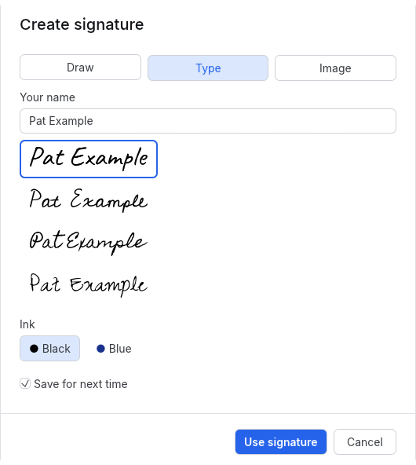

[User guide](README.md) › Everyday tasks

# Fill and sign

Put your signature, initials, the date, your name, other text, or a tick, cross or dot on a document: for signing
something someone sent you, or filling in a form that has no fields to type in.

This puts a picture of your signature on the page. It isn't a digital signature: it doesn't prove who signed, and
anyone can copy it. For a signature that does, see [Digital signatures](signatures.md).

## Sign a document

1. Click **Fill and sign** in the top bar (its icon is a signature).
2. Click on the page where your signature goes, or drag a box to size it. The first time, the Create signature
   window opens first: draw, type or choose a picture of your signature, then press **Use signature**.
3. Add the date, your initials or a tick the same way: pick it in the Fill and sign pane on the right, then click
   on the page.
4. Move or resize anything that isn't quite right: click it with the read tool and drag it or its handles.
5. Press **Finish signing…** in the notice above the pages, then save.

The small arrow beside the Fill and sign button opens a menu of everything it can put down: Signature and
Initials, each listing the saved ones and Create…, then Date, Your name, Text, Tick, Cross and Dot. Picking one
turns the tool on with it; the button itself turns the tool on with the item picked last.

## Make your signature

**Create signature…**, in the button's Signature menu, the Fill and sign pane (or **New…** beside Signatures in
the pane), ☰ > Tools or the command palette (Ctrl+K), opens a window with three ways to make one (Create
initials… likewise):

- **Draw:** sign on the white pad with the mouse, touchpad or a pen; Clear starts again. The strokes are smoothed
  into curves and stay sharp at any zoom. In a narrow or short window the pad is smaller, at the same shape; what
  is drawn keeps its shape and comes out the same size on the page, also when the window is resized while drawing.
- **Type:** type your name (it starts as your name for comments) and pick one of four handwriting styles (Caveat,
  Cedarville Cursive, Homemade Apple and Zeyada), shown as they will look on white paper, the chosen one outlined. Each has Latin characters, and Caveat
  Cyrillic too; for a name a style can't show, the message names the styles that can, or draw it or use a picture.
- **Image:** choose a photo or scan of your signature on paper (PNG, JPEG or TIFF). **Make the paper transparent**
  (on by default) keeps only the ink and cuts off the empty margins, so the signature sits on the page like ink. It
  finds a small signature on a whole sheet too, and leaves out shadows, the paper's grain and stray specks. Other
  writing on the sheet (a printed letter, say) counts as ink: drag around your signature on the picture to use only
  that part, and **Use the whole picture** to go back. From the keyboard, Tab to the picture: the arrow keys move
  the part used (the middle half to begin with), and Shift with an arrow key makes it wider, narrower, taller or
  shorter. The preview under it shows the result. When LimarePDF can't tell the signature from the paper (a blank
  or very faint picture), it says so: drag around the signature, or untick Make the paper transparent. Your
  picture file isn't changed, and a saved signature keeps the part chosen. CMYK JPEGs (from some print workflows)
  work as other pictures do.

The window also has the ink colour (the same choice as the pane's). **Use signature** puts it in the list. Esc
closes the window only while nothing is drawn, typed (beyond the name it starts with) or chosen; picking another
tool closes it.

**Initials** are made the same way, with **New…** beside Initials; typing starts with your name's initials.

## Saved signatures

Each new signature or set of initials goes first in its list in the pane, up to five of each. Right-click one to
take it off the list.

**Save for next time** (on by default) keeps it in the list when LimarePDF starts again. Unticked, it stays in the
list until LimarePDF closes, marked "until LimarePDF closes", and is then gone. Saved signatures are stored
unencrypted in LimarePDF's settings folder (`signatures.txt`, and pictures copied into its `signatures` folder), on
this computer only; taking a picture off the list deletes its copy. If it can't be saved there, a message says so,
and it stays in the list until LimarePDF closes ([why](troubleshooting.md#settings-not-saved)).

## What you can put down

Pick an item in the pane, then click on the page to put it down at its usual size, centred on the click, or drag a
box to size it (it keeps its shape inside the box). The read tool then comes back with the item selected, to move
or resize it. To sign several places in a row, pin the tool (see [Keep tool active](gui.md#keep-tool-active)).

- **Signature and initials:** a signature is up to 150 by 50 points, initials up to 50 by 30.
- **Date:** today's date on your computer, in the style picked beside it: 2026-10-16, 16 October 2026 or
  October 16, 2026. The date is a text box: double-click it to change it.
- **Name:** your name for comments (the same as ☰ > Edit > Your name for comments). A name with characters
  beyond Latin, Greek and Cyrillic (or with emoji) can't be put down: a message says which.
- **Text:** type in the box, then click on the page; for anything else a form asks for. Like the name and date,
  it is a text box in Helvetica, so it takes Latin, Greek and Cyrillic characters; others (Chinese, emoji and so
  on) aren't typed, and a note at the caret says so.
- **Tick, cross and dot:** for boxes that aren't real form fields.
- **Ink:** black or blue, for what is put down next.

The style choices are remembered.

**Signature fields:** clicking an empty one, with the Fill and sign tool or the read tool, puts the picked
signature (or initials) inside its box. The field itself stays digitally unsigned, so other readers don't report a
broken signature.

## Move, then finish

What you put down is added as annotations, so it can still be moved, resized or deleted: click an item with the
read tool (or Ctrl+click it with another tool) to select it. The Comments view lists them as "Signature",
"Initials", "Tick" and so on.

While there are such items, a notice above the pages says how many and has a **Finish signing…** button; the Fill
and sign pane has the same button, and so does ☰ > Document. Finish signing draws them into the pages as they look,
after asking, so they can no longer be moved or removed as comments. Undo brings them back until you close the
document. Other comments and stamps are left alone.

Saving without finishing keeps them movable, and the notice comes back when the document is opened again.

## From the command line

`limarepdf-cli stamp --signature "Your Name"` puts a typed signature on a page, and `--image` a picture of one:
see [Stamps](cli.md#stamps).

---

[← Filling in forms](forms.md) · [User guide](README.md) · [Headers, footers, watermarks and stamps →](headers-footers-watermarks.md)
