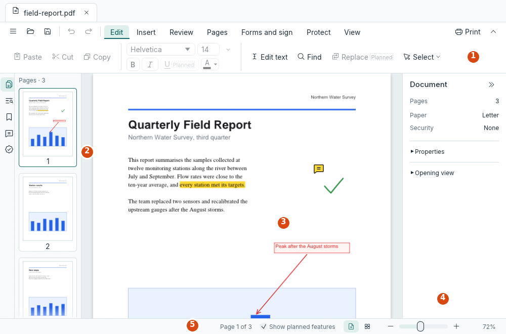

[User guide](README.md) › Getting started

# First steps

This page takes you through a first session in the desktop app: opening a PDF, finding your way around, making a
change and saving it. Shortcuts are written with Ctrl; on a Mac, use ⌘ (Command) instead.

## Open a document

1. Start LimarePDF from your applications menu (the Start menu on Windows, Applications on macOS). The start screen
   lists the PDFs you opened recently: click one to open it again.
2. Open a PDF with the **Open** button at the top left, or Ctrl+O. You can also drop a file on the window (except
   on Linux in a Wayland session, see [Troubleshooting](troubleshooting.md#dropping-files-on-the-window-does-nothing)).
3. The document opens in a tab of its own. Open more and switch between them with the tabs.

Photos and scans (PNG, JPEG or TIFF) open as a new document, one page per picture. The start screen's **Make a PDF
from images…** does the same.

From a terminal, `limarepdf report.pdf --page 3` opens a document at page 3.

## Find your way around



1. **The top bar** has, from the left: the menu ☰, which holds every command; Open, Save and Export; Undo and
   Redo; the tools (Read and select text, Add text, Add image, Redact, Fill and sign, and Comment for notes, shapes
   and drawings); and at the right, Search and Print. Hover over a button to see what it does. A tool's tooltip
   also says how to use it.
2. **The left side** shows the page thumbnails, and has icons for Search results, Bookmarks and Comments. Click an
   icon to open that view; click it again to fold the panel away.
3. **The middle** shows the pages. Scroll with the mouse wheel or touchpad. Ctrl+scroll, Ctrl+= and Ctrl+- zoom,
   and Ctrl+0 fits the pages to the window's width again.
4. **The right side** is the inspector, which shows the options for whatever you have selected.
5. **The bottom bar** shows the page you are on and messages, and at the right the page layout (one column, two
   pages side by side, or one page at a time), Fit width and the zoom.

Notices above the pages tell you about the document when it opens: that it is a form, a scan without text,
digitally signed, damaged and repaired, and so on. Each has a button for what to do about it, and × to dismiss it.

## Select something and change it

Documents open with the read tool, the text cursor. It does most things:

- **Text:** drag across it to select it. Ctrl+C copies it. A small toolbar next to the selection offers Highlight,
  Redact and more.
- **A line of text:** double-click it to edit it where it is. Press Enter, or click elsewhere, to keep the change.
- **A picture, shape or comment:** click it to select it. The inspector shows its options, and changes apply as you
  make them. Drag it, or use the arrow keys, to move it.
- **Pages:** click a thumbnail to select its page (Shift+click for a range, Ctrl+click for one more). The inspector
  then offers rotate, delete, extract and insert. Drag thumbnails to put pages in a new order.
- **The whole document:** with nothing selected (Esc clears a selection), the inspector shows the document's
  settings: properties, password security, watermark, headers and footers, text recognition and more.


Right-click anything for a short menu of what you can do with it.

The other tools put something new on the page: pick one in the top bar, then click or drag on the page. After
putting one thing down, a tool goes back to the read tool (the pin in its options keeps it on). Esc always
returns to the read tool.

## Find any command

Press **Ctrl+K** to open the command palette. Type a few letters of what you want, such as "rotate", "watermark" or
"split", and press Enter. The ☰ menu also has every command, grouped into File, Edit, View, Tools, Pages, Document
and Help.

## Undo, save and keep your work safe

- **Undo** with Ctrl+Z, up to 20 steps back, and **redo** with Ctrl+Y.
- A **\*** after a tab's name means the document has unsaved changes. **Save** with Ctrl+S. **Save As**
  (Ctrl+Shift+S) writes a new file and leaves the original as it was, which is the safe choice for documents that
  matter.
- Your file is only changed when you save. Closing a document or quitting with unsaved changes asks whether to
  **Save** them, **Discard** them or **Cancel**; with several documents unsaved, quitting offers **Review…** to
  ask about each in turn. Save asks first when another app changed the file since you opened it.
- While you work, LimarePDF keeps a private **recovery copy** of each document with unsaved changes. If the app
  stops unexpectedly, the next start offers them back ([Recovery copies](gui.md#recovery-copies)).
- In a question, a **red button** means what it does can't be undone (such as applying redactions), or breaks a
  document's digital signatures.

## Good to know

- **Privacy:** LimarePDF never connects to the network. A link to a website asks first, then opens in your
  browser.
- **An early version:** LimarePDF is being tested, mostly on Linux so far. Before relying on a feature, check
  [what doesn't work yet](features.md#what-doesnt-work-yet), and keep a copy of important documents.
- **Your settings** (theme, recent files, your name for comments, saved signatures, digital IDs) are kept on your
  computer only ([where](troubleshooting.md#where-limarepdf-keeps-things)).
- **Help:** tooltips explain every button, this guide covers every task, and
  [Troubleshooting](troubleshooting.md) covers common problems and how to report one.

## The command line, in one minute

LimarePDF also comes with `limarepdf-cli`, which does the same things from a terminal, for scripts and batches.
Commands that change a document write the result to a new file (`-o`) and never change the input:

```
limarepdf-cli info report.pdf
limarepdf-cli merge a.pdf b.pdf -o both.pdf
limarepdf-cli extract report.pdf -o summary.pdf --pages 1-3,7
limarepdf-cli ocr scan.pdf -o searchable.pdf
limarepdf-cli watermark report.pdf -o draft.pdf --text DRAFT --opacity 0.3
limarepdf-cli form fill form.pdf -o filled.pdf --set name=Ann --set agree=on
```

Every command lists its options with `limarepdf-cli <command> --help`; the
[command-line reference](cli.md) has them all.

## Where to go next

Check [what works and what doesn't](features.md) next, then go to the task you need in the
[user guide](README.md#everyday-tasks).

---

[← Install LimarePDF](install.md) · [User guide](README.md) · [Features and status →](features.md)
