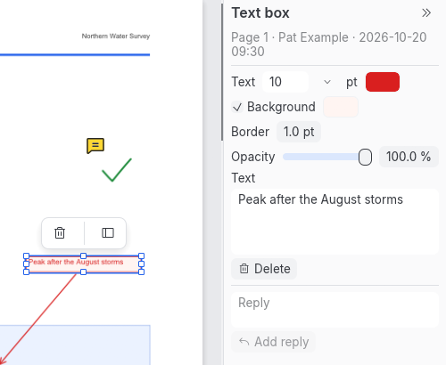

[User guide](README.md) › Reference

# The desktop app

A reference for every part of the desktop app: the window, the tools, opening and saving, recovery copies, the
inspector, keyboard shortcuts and settings. For step-by-step help with a task, see the
[everyday tasks](README.md#everyday-tasks). Shortcuts are written with Ctrl; on a Mac, use ⌘ (Command) instead.

## The window

- **Top bar:** the menu (☰), Open, Save and an Export menu (pages as images, text); Undo and Redo; the tools: Read
  and select text, Add text, Add image, Redact and Fill and sign, then the Comment button with its menu (notes, text
  boxes, shapes, the pen, stamps) and the Tools menu, which holds every tool; at the right, Search and Print. The
  buttons are icons, each named by its tooltip; a tool's tooltip also says how to use it. As the window narrows,
  the search field becomes an icon, and then the tools fold one by one into the Tools menu: the Comment button
  first, then Add image, Redact, Add text and Fill and sign, coming back in reverse as the window widens. In very
  narrow windows Export and then Undo and Redo leave the bar too (they stay in ☰, and Undo and Redo on their keys).
  Read and select text stays. The Tools menu shows the current tool when that one isn't on the bar.
- **Tabs:** one per document, with a × inside it to close it. A * after the name means unsaved changes.
- **Bottom:** the page you are on and messages at the left; at the right, the page layout, Fit width and the zoom
  (see [Reading and finding](reading-and-finding.md#move-around-the-pages)).
- **Left:** a column of icons for the navigation panel's views: Pages (the thumbnails), Search results, Bookmarks
  (the document's outline) and Comments. Clicking a view opens it; clicking the open one folds the panel away, and
  clicking it again brings it back. Documents open on Pages, unless the file asks to open on its bookmarks. The
  same panel lists the document's digital signatures, from ☰ > Document > Digital signatures > Signatures in this
  document. See [Bookmarks](reading-and-finding.md#bookmarks), [Search](reading-and-finding.md#find-words),
  [Comments](comments-and-markup.md#see-every-comment-and-reply) and [Digital signatures](signatures.md).
- **Middle:** the pages, scrolling continuously. By default they fit the width between the side panels; zooming
  turns that off. Continuous, facing or single pages: see [Page layout](reading-and-finding.md#page-layout).
- **Right:** the inspector, which shows options for what is selected (see
  [The inspector](#selecting-and-the-inspector)). The » at its top collapses it to a strip; the « at the top of the
  strip expands it again, and the strip's options button shows the inspector's contents in a pop-out over the pages
  (a click elsewhere or Esc closes it; what you changed in it stays). ☰ > View > Inspector does the same.
- **Narrow windows:** below about 960 points wide the inspector collapses to its strip by itself, and below about
  760 the navigation panel folds away to its icons. They come back when the window is wide enough again, unless
  you closed them yourself; a panel you open in a narrow window stays open. Whether you closed or opened each
  panel is remembered between runs.

Ctrl+K opens the command palette, which lists every command. Type to filter, use Up and Down to choose, and press
Enter to run; Esc closes it. It looks like the dialogs, without a title or buttons: a search field, then each
command with its category and shortcut in columns.

## The tools

Documents open with the read tool, Read and select text (the text cursor). It selects text, follows links, fills in
forms, edits a line of text when you double-click it, and selects pictures, shapes and comments to move them. The
other tools:

| Tool | What it does | See |
| --- | --- | --- |
| Select, move and resize objects (the arrow, in ☰ > Tools) | Selects any object, page text and full-page pictures included | [Editing](content-editing.md#move-resize-or-delete) |
| Add text | Click and type new text | [Add text](content-editing.md#add-text) |
| Add image | Choose a picture, then drag a box | [Add a picture](content-editing.md#add-a-picture) |
| Redact | Drag a box to mark an area for redaction | [Redaction](redaction.md) |
| Fill and sign | Your signature, initials, the date and other items | [Fill and sign](fill-and-sign.md) |
| Comment: note, text box, rectangle, ellipse, line, pen | Annotations other readers list as comments | [Comments and markup](comments-and-markup.md) |
| Comment: stamp | Approved, Draft, your own wording or a picture | [Stamps](headers-footers-watermarks.md#stamps) |

Esc always returns to the read tool, and LimarePDF always starts with it. With a tool other than the read tool on,
hold Ctrl and click to follow a link, fill in a field or select a comment.

### Keep tool active

The tools that put something down (Add text, Add image, the note, text box, rectangle, ellipse and line, stamps,
Redact and Fill and sign) go back to the read tool once they have put one thing down, with the new item selected
so you can adjust it. The pin at the top right of a tool's options, Keep tool active, keeps that tool on instead,
so you can put down several in a row; Esc or another tool leaves it. Each tool's pin is its own (pinning Redact
doesn't pin Fill and sign) and is remembered between runs. The Note tool has no pin: kept on, every click would put
down a note, so existing notes couldn't be opened or deleted. The pen always stays on until Esc or another tool,
since a drawing takes several strokes.

## Opening files

Open PDFs with the Open button, Ctrl+O, or by dropping them on the window. Image files (PNG, JPEG, TIFF) open as a
new document with one page per image; the start screen's Make a PDF from images… does the same (see
[Scans and OCR](scanning-and-ocr.md)). From a terminal, `limarepdf file.pdf --page 3` opens a file at page 3.

On Linux in a Wayland session, dropping files on the window does nothing yet: see
[Troubleshooting](troubleshooting.md#dropping-files-on-the-window-does-nothing).

Recently opened PDFs are listed on the start screen and under ☰ > File > Open recent, which also clears the list.
Files that no longer exist are left out. The list holds 10 files and is kept on your computer only, in
`~/.config/limarepdf/recent.txt` on Linux, `~/Library/Application Support/limarepdf/recent.txt` on macOS, and
`%APPDATA%\limarepdf\recent.txt` on Windows.

Each document gets a tab. The tab shows its name, with `*` while it has unsaved changes.

Closing a document or quitting asks first when there are unsaved changes, including text still being typed: a
comment or text box on the page, a form field, the selected comment's changes in the inspector, or a reply not yet
added. Saving keeps that text first, as clicking away would (Undo takes it back).

If a damaged file makes LimarePDF fail while showing a document, that tab shows an error page with Save a copy and
Close this tab; other tabs carry on.

## Saving

Save (Ctrl+S) writes the document over its file; Save As (Ctrl+Shift+S) writes a new file and leaves the original
as it was. Your file is only changed when you save.

Saving writes a temporary file beside the document and then replaces the document with it, so a save that fails
part way leaves the original as it was. On Linux and macOS, the temporary file is readable only by you while it is
written, and the saved document keeps the original's permissions; afterwards LimarePDF asks the system to confirm
the change is on disk, so a power cut can't undo it. If the system can't confirm it, a message says "The file was
saved, but your system couldn't confirm it is safely on disk. If the computer lost power just now, save it again.",
and the document stays marked unsaved so saving again is one click. (Windows has no way to confirm this: there a
power cut in the moment after a save can still lose it.)

LimarePDF saves by rewriting the whole file, except for a digitally signed document: its changes are added after
what was signed, so the signatures stay valid. LimarePDF asks first when the signatures don't allow the changes,
and before writing a signed document in full when it must (after redacting, for example), which breaks the
signatures; see [Saving a signed document](signatures.md#saving-a-signed-document). Save As to a new file keeps the
signed original.

## Undo

Everything that changes the document can be undone with Ctrl+Z, and redone with Ctrl+Y (or Ctrl+Shift+Z), up to 20
steps back. Each step keeps a whole copy of the document, and a document's steps are limited to 1 GB together, so
undo goes back fewer steps on very large documents (about 7 on a 139 MB scan); the latest change can always be
undone. Deleting shows a notice with an Undo button.

While you type in a line, a note, a text box, a form field or any of the inspector's boxes, Ctrl+Z and Ctrl+Y undo
and redo the typing there and nothing else; with nothing left to undo there, they do nothing. Once it is kept (when
you leave the box), Undo takes the whole change back, and the box starts with nothing to undo when you come back to
it.

## Dialogs

Dialogs (questions, messages, Print, Create signature, the digital signature windows, About) open over a dimmed
window, which takes no clicks or shortcuts until the dialog closes. Each names its task, and the document when it
acts on one. The button that does the task is highlighted, or red when what it does can't be taken back with Undo,
or breaks signatures; on Windows and Linux it comes before Cancel, on macOS after. Esc is Cancel, except in a window
holding work you would lose (a signature drawn, typed or chosen; a digital ID form; a signing form with something
typed), where only Cancel closes it. A message's Copy button copies what it says, to pass on an error. Reasons and
technical lists in a question are under Details.

A dialog fits the window, also as it is resized: narrower in a narrow one, with smaller margins under 600 points
wide, and in a short one its content scrolls while its buttons stay in view. Very long names are cut short: a
file's under the title, and a printer's in Print (shown whole on hover and in the list of printers). Every dialog
has the same look: text at 14 points, settings in headed groups, labels above the fields, fields, lists and buttons
outlined, and radio buttons and checkboxes outlined on the dialog's background. Two short fields share a row when
there is room (Copies and Print on, a signature's Reason and Location) and go one under the other when not. Lists
of documents or certificates are an outlined box with each row's buttons on its right (under it in a narrow
window); facts to read, such as a certificate's, have their names in a column on the left.

A question about a document (Flatten, Apply redactions, Discard changes and the others) acts on the document it was
asked about, even if another tab has come to the front meanwhile, and brings it back to the front. If that document
changed or was closed while the question was open, nothing is done, and a message says so.

## Notices about the document

When a document opens, notices above the pages point out things worth knowing, each with a button where there is
something to do and × to dismiss it. At most two show at a time.

| Notice | Button |
| --- | --- |
| Its digital signatures are being checked, and then how they checked, coloured green, amber, grey or red (always first; see [Digital signatures](signatures.md#checking-a-signed-pdf)) | Signatures |
| It was restored from a recovery copy, as it was at the time shown, and isn't saved; a signed document's signatures aren't checked ([Recovery copies](#recovery-copies)) | Save as… |
| An earlier recovery copy, made before content was removed, couldn't be deleted, and where it is | Show file |
| Recovery copies of it can't be kept right now, and why | Save |
| The file is damaged, and LimarePDF repaired it to open it: some content may be missing. The original stays as it is: the document counts as changed (closing it warns of unsaved changes), and Save asks whether to replace the original or save the repaired copy as a new file. A signed file's signatures can't vouch for what is shown (they show *can't check*, or a change that isn't allowed), and the repaired copy can't keep them ([details](rendering.md#damaged-files)) | Save as… |
| The file isn't put together quite as the PDF format asks, so other PDF apps may show it differently: some content could be missing or different in them. Saving a copy writes it the way LimarePDF shows it, which every app reads the same, and the notice goes. Not shown for repaired files (the notice above covers them) or signed ones (their signatures show *can't check* and say why) ([details](rendering.md#files-other-apps-may-show-differently)) | Save as… |
| The document was password-protected: saving removes the protection unless you set it again. A document that opens without a password but has a permissions password (which can limit printing, copying or changes; other readers open it without asking too) says so instead: saving removes that password unless you set it again ([Password protection](security.md)) | Password security |
| Areas are marked for redaction but the marks haven't been applied (kept up to date while you work; [Redaction](redaction.md)) | Apply redactions… |
| Signatures and other items put down with the Fill and sign tool can still be moved (kept up to date while you work; [Fill and sign](fill-and-sign.md#move-then-finish)) | Finish signing… |
| Its pages are scans without text, so they cannot be searched or copied (checked on the first 20 pages; [Scans and OCR](scanning-and-ocr.md)) | Recognise text |
| A page has more annotations than LimarePDF shows (10,000), so some can't be seen or chosen; Remove comments, removing attachments and redaction still deal with all of them, and redaction marks among them are applied | |
| It is a form made for Adobe Reader (an XFA form), which only Adobe software can show or fill in; LimarePDF shows the placeholder page the file contains, often "Please wait..." | |
| Parts of it couldn't be drawn: a picture that can't be decoded. Found as pages are drawn, so it can appear later; it comes back if something new turns up after you dismiss it | |
| Fonts it names aren't in the file or installed: which ones are shown with a similar font, or which language's text can't be shown at all, and what to install to see it as it was made (such as Noto Sans CJK JP for Japanese). Found as pages are drawn, like the one above ([details](rendering.md#fonts-that-arent-embedded)) | |
| It has a form: click a field to fill it in, or press Tab (not for a form of signature fields alone; [Filling in forms](forms.md)) | Highlight fields |
| It is large (more than 500 pages or 100 MB) | |

The password and scanned-pages notices go away by themselves once dealt with: after password security is applied,
or after text has been recognised.

## Recovery copies

While you work, LimarePDF keeps a private copy of each document with unsaved changes, so that if it stops without
closing normally (a crash, the system ending it, a power cut), the next start can offer the documents back. These
copies are not autosave: **your own files are never written by them.**

- A copy is made about a minute after you change a document, then at most once a minute while you go on changing it.
  It holds the document as it was then, so changes made in the last minute or so before a crash can be lost. Text
  still being typed (a comment, a form field, a reply) isn't in a copy until it is kept, by clicking away or
  applying it.
- Saving or closing a document deletes its copy, and quitting normally deletes them all.
- Password-protected documents get no copies: not one opened with a password, not one you set a password on (its
  copy is deleted first), not pages taken from one, and not a document you add a protected document's pages to
  with Append PDFs (its copy is deleted first too; this includes protected files that open without a password).
- The copies are kept in a folder only you can read: `~/.local/state/limarepdf/recovery` on Linux (or
  `$XDG_STATE_HOME/limarepdf/recovery`), `~/Library/Application Support/limarepdf/recovery` on macOS, and
  `%LOCALAPPDATA%\limarepdf\recovery` on Windows. At the start, LimarePDF looks only in real folders of yours there:
  a recovery folder, or a folder inside it, that is a symbolic link or belongs to another user is left untouched.
- To stop them, turn off ☰ > File > **Keep recovery copies of unsaved changes** (also in the command palette).
  Copies already made are deleted at once, and the choice is remembered.
- If a copy can't be written, for example when the disk would be left with less than 1 GB free, a notice on the
  document says so, with a Save button. If recovery can't start at all, a message says so when the app starts.

**After a crash.** The next start lists the documents that had copies: name, where the document came from, when the
copy was made, how many pages, and until when the copy is kept. **Restore** opens one as a new, unsaved document
called "*name* (recovered)", with a notice saying when the copy was made; Save suggests "*name* (recovered).pdf"
beside the original. **Discard** deletes the copy. **Not now** keeps them all and asks again at the next start.
Copies are deleted 30 days after the crash if you do neither. A copy that turns out to be damaged is listed as such,
with Show file and Discard; so is one whose description LimarePDF wrote beside it is damaged, a time in it past the
year 9999 included. Damaged copies never stop LimarePDF from starting. A restored document's copy stays until you
save or close it, so a second crash doesn't lose it, or until you remove content from it or set a password (below).
Files given on the command line open once the list is closed.

A restored copy of a digitally signed document is LimarePDF's working copy, not the signed file, so its signatures
cover bytes that aren't in it. They aren't checked: the Digital signatures view lists each one as "Not checked:
recovered copy". Open the original to check them. Saving or signing the copy writes the whole file, which makes
them invalid, so LimarePDF asks first.

**Redactions, hidden information and passwords.** Once you apply redactions, remove hidden information or set a
password, no recovery copy made before can be offered after a crash: LimarePDF deletes the document's copy first,
and for a restored document the copy it came from, and makes a new one afterwards (none for a password), which
holds none of what was removed. Undoing a redaction or removal brings the content back, and the next copy holds it;
Redo then deletes that copy first too. If it can't delete a copy, the command (or Redo) doesn't run, and a message
says where the copy is, with Show file: delete it, or turn off recovery copies (which doesn't remove the copy a
restored document came from), then try again. If the copy was deleted but the disk can't confirm it (a power cut
could bring it back), the command doesn't run either, at every try, until the disk confirms it. If the copy
could be made unusable but its file couldn't be deleted, the command runs, and a notice says where the file is until
LimarePDF manages to delete it, or you do. The limits of this promise:

- A deleted file's bytes stay on the disk until they are overwritten, and on SSDs nothing reliably wipes them.
- On Windows a deletion counts as done once the file's name is gone, which NTFS normally keeps across a power cut but
  doesn't guarantee for the last moments before one.
- It covers recovery copies only. They never change your original file, so it holds whatever it held until you save
  over it.

## Selecting and the inspector

What you select decides what the inspector, the right-click menu and the floating toolbar offer.

| Selected | Inspector |
| --- | --- |
| Nothing | The document: properties, opening view, password security, the form (when there is one), crop, watermark, headers/footers/Bates, OCR, optimise scanned pages, export pages as images, split into files, and buttons for export text, print and append PDFs |
| Pages (click thumbnails; Shift for a range, Ctrl for one more) | Rotate, delete, extract to a new tab, insert images or a blank page after them, page labels from the first selected page, and the crop, watermark, headers/footers, OCR and optimise tools with the pages filled in ([Organising pages](organising-pages.md)) |
| An object, a comment, or a tool that adds content | That object's or tool's options. For a line of text being edited, or new text being typed, the font, Bold, Italic, size and colour of the words selected in it, blank where they mix values ([Style words in a line](content-editing.md#style-words-in-a-line)) |
| Words | Nothing of their own: the inspector stays on the document or pages. Copy, highlight, redact, print and save the selection from the floating toolbar (or the docked buttons) and the right-click menu |

The inspector holds controls, with at most a short line about state (such as how many areas are marked); how to
use a tool is in its tooltip in the top bar and the menus, and in this guide. Menu commands for document and page
settings open the matching section of the inspector.

The page and document settings apply as you set them, with no Apply button, each change one undo step: typed
text when you press Enter or leave the field, a choice at once, a number when you stop dragging it or leave its
box. Saving or closing keeps a field you are still typing in. Password security is the exception: its Apply button
sets the passwords, which take effect when you save.

Right-click a page, an object, selected words or a thumbnail for a short menu of what applies there.
Right-clicking selects what is under the pointer first. A selected object or run of words also gets a small
floating toolbar with the same commands. Its last button, Dock controls on the right, moves these buttons to the
top of the inspector (or its strip, when collapsed) instead; Float controls near selection there brings the
floating toolbar back. ☰ > View > Selection controls on the right does either. The choice is remembered between
runs; resizing the window doesn't change it.

Delete removes the selected object, comment or mark, or the selected pages.

### Pages boxes

Pages boxes, in the inspector's tools and the print dialog, take page numbers and ranges counted from 1, such as
`1-3,7`, `5-` (5 to the end) or `all`. Clicking or tabbing into a box that says `all` selects it, so typing page
numbers replaces it.

### Document properties

The inspector's Properties section, with nothing selected (or ☰ > Document > Properties…), shows the document's
title, author, subject, keywords, creator and producer. Each is kept as you type it, when you press Enter or leave
the field, one undo step each. To remove them for good, along with other information that isn't on any page, see
[Removing hidden information](redaction.md#removing-hidden-information).

### Opening view

Opening view, in the document's inspector, is how viewers that follow it show the document when it opens: its
layout (continuous, facing, facing with the cover alone, or single page), the side panel (Pages or Bookmarks) and
the page it opens at. Each can be left as Not set. Each choice applies as you make it, and Use current view sets
all three from how you are viewing the document now; Undo reverses any of them.

## Keyboard shortcuts

Shortcuts show ⌘ instead of Ctrl on macOS.

| Keys | Action |
| --- | --- |
| Ctrl+O | Open |
| Ctrl+S, Ctrl+Shift+S | Save, Save As |
| Ctrl+W | Close the tab |
| Ctrl+P | Print |
| Ctrl+Z, Ctrl+Y (or Ctrl+Shift+Z) | Undo, redo |
| Ctrl+F | Search |
| Ctrl+K | Command palette |
| Ctrl+= , Ctrl+- | Zoom in, zoom out |
| Ctrl+0, Ctrl+1 | Fit width on or off, actual size |
| Ctrl+scroll, pinch | Zoom |
| PageUp, PageDown, Home, End | Previous, next, first, last page |
| Delete, Backspace | Delete the selected object, comment or mark, or the selected pages |
| Ctrl+Shift+H | Highlight the selected text |
| Arrow keys (Shift for 10 points) | Move the selected object |
| Ctrl+A, Ctrl+C | Select all text on the page, copy it (read tool) |
| Esc | Cancel: close an open list, menu or colour picker (only that), finish (and keep) new text, a line, a note, a text box or a form field being typed, clear the selection, or leave a tool for the read tool |
| Ctrl+B, Ctrl+I | Bold, Italic for the words selected in new text being typed (Add text) or a line being edited on the page; with nothing selected, the word at the caret, or what is typed next between words |
| Ctrl+Z, Ctrl+Y (or Ctrl+Shift+Z) while typing new text, a line, a note, a text box, a form field or in any box of the inspector | Undo, redo the typing there (and the styles, in new text and lines), not the document |
| Tab, Shift+Tab | Next, previous form field; Space ticks a checkbox or opens a list |
| Tab, Shift+Tab (a document without fillable fields) | Next, previous button or field: the top bar, tabs, bottom bar and panels left to right; inside a dialog, its fields and then its buttons. Space or Enter presses the button. In a form, Tab moves between its fields; Ctrl+K reaches every command |

### Screen readers

Every button, field, list and menu has a name a screen reader can say, in the window, the inspector, the side
views and the dialogs: icons and symbols are named in words (◀ and ▶ in Search results are Previous match and
Next match), a field is named by the label beside it, and toggles such as Bold and Italic, the picked signature
and the picked mark say whether they are on. An open list or menu is named after the button that opened it. In a
list with a button on each row, the button names its row: Restore Report.pdf in Recover unsaved changes, Remove
Jane Example… in Trusted certificates. The edges of the side panel and the inspector are named Side panel width
and Inspector width, but can only be dragged with the mouse.

The names are checked by the app's tests on Linux. LimarePDF hasn't been tried with a screen reader yet (Orca,
Narrator or VoiceOver).

## Look and feel

The app follows the system's light or dark theme. ☰ > View > Theme chooses System, Light or Dark. The choice is
remembered between runs, in `settings.txt` in the same folder as the recent-files list, along with the markup
colours and your name for comments. For darker pages too, see
[Page colours for reading](reading-and-finding.md#page-colours-for-reading).

The app uses the Inter font and Phosphor icons. It also includes the Liberation fonts, which have the widths of
Helvetica, Times and Courier, to show text in its own look while it is typed on the page and to write characters
Helvetica, Times and Courier lack; they don't add to the fonts you can choose.

The window opens at the size it had when the app last closed, and maximized if it was; a maximized window keeps
the size it had before, for when you restore it. A size kept on a larger monitor is shrunk to fit a smaller one.
Its position isn't remembered: on Linux Wayland sessions the desktop places windows, not the app, and tiling window
managers choose the size themselves. On KDE Wayland, restoring a window that opened maximized puts it at the
top-left of the screen, since the desktop never placed it at its normal size; a later start places it as usual.

☰ > Help > About shows the version (the Copy button next to it copies the version and system, for a bug report),
links to the website, the licence and the issue tracker, which open in your browser, and Credits for the bundled
fonts, icons and text recognition model. Contributors switches the window to the people who made LimarePDF; Back
returns. LimarePDF is made in Canada, which the About window and the foot of the start screen say beside a maple
leaf.

---

[← Digital signatures](signatures.md) · [User guide](README.md) · [The command line →](cli.md)
