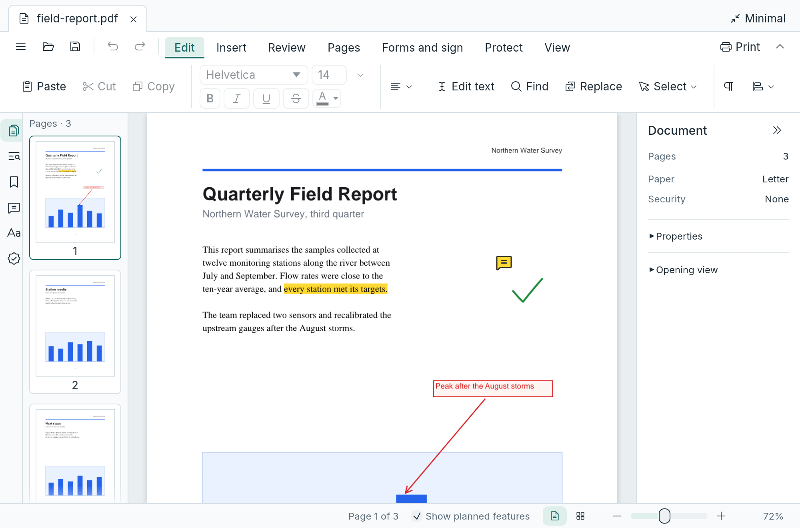
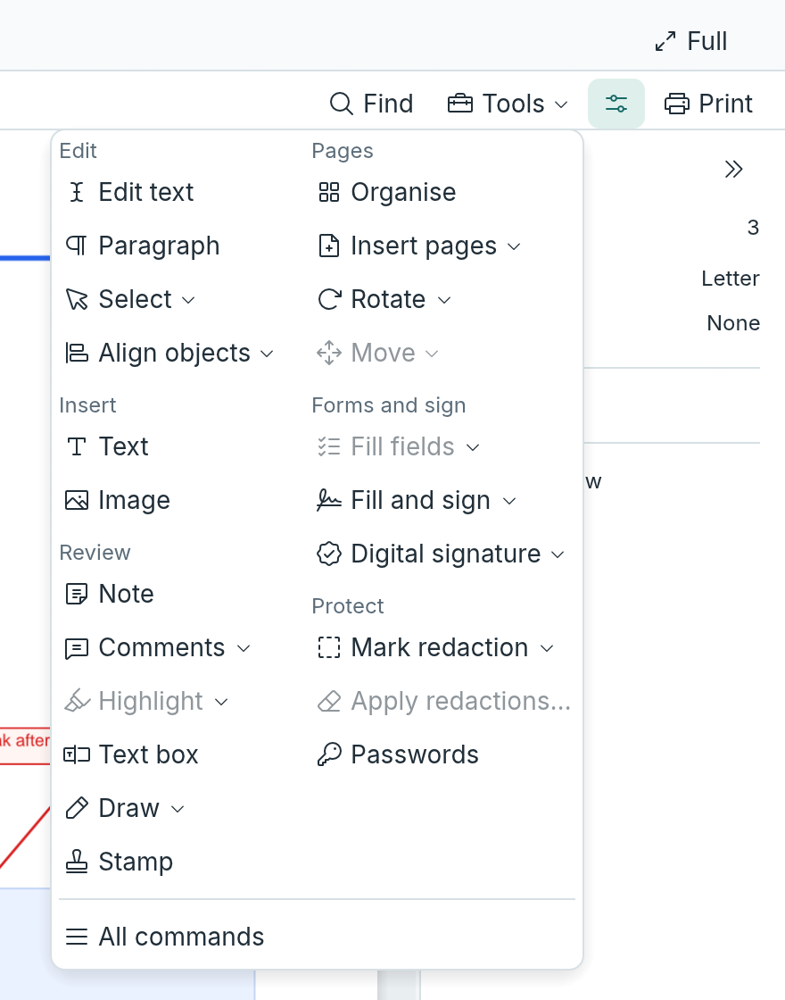
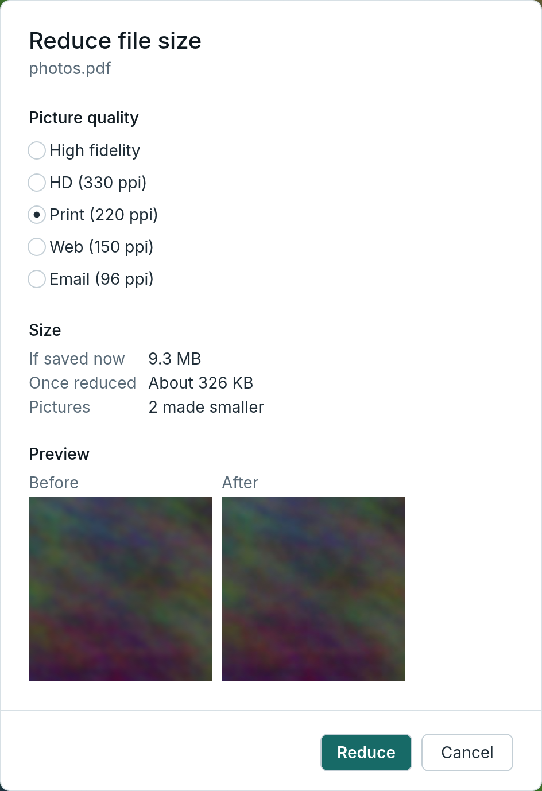
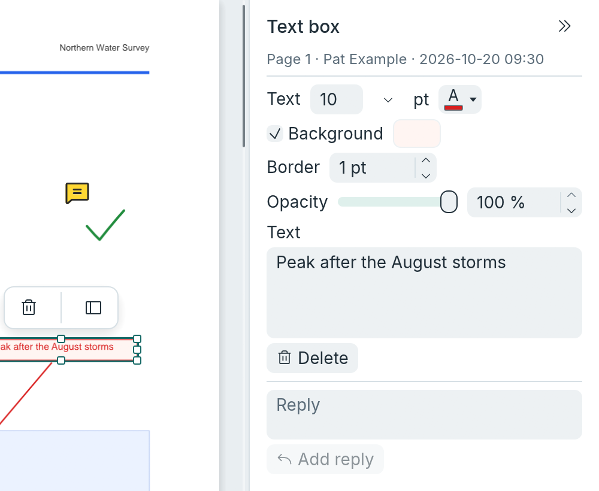

[User guide](README.md) › Reference

# The desktop app

A reference for every part of the desktop app: the window, the tools, opening and saving, recovery copies, the
inspector, keyboard shortcuts and settings. For step-by-step help with a task, see the
[everyday tasks](README.md#everyday-tasks). Shortcuts are written with Ctrl and Alt; on a Mac, use ⌘ (Command) and
⌥ (Option) instead.

## The window

- **Tabs**, at the top: one per document, with a × inside it to close it. **Unsaved** beside the name means
  unsaved changes, from the first key you type. With many open they share the row and then scroll
  ([Opening files](#opening-files)). Text you are typing on a page (new text, a line, a note or text
  box) stays open while you look at another tab; back on its tab, you go on typing where you were. At the right
  end of the tabs, **Minimal** switches to the [Minimal interface](#the-minimal-interface), one quiet row of
  commands in place of the band, and **Full** switches back.
- **The commands row**, under the tabs: at the left the File menu (☰), Open and Save, then Undo and Redo, as icons
  named by their tooltips; then the names of the command band, **Edit**, **Insert**, **Review**, **Pages**,
  **Forms and sign**, **Protect** and **View**; at the right **Print**, and a small arrow that makes the commands
  compact. The File menu has File's own commands, as word processors order them (New blank document, Make a PDF
  from images, Open, Open recent, Save, Save As, Reload, Export ▸, Reduce file size, Print preview, Print, Print
  selected text, Properties), then one submenu for each name of the command band, with the same names in the same order and
  laid out as the band's groups (Edit, Insert, Review, Pages, Forms and sign, Protect, View), then Help (Search
  commands, User guide, Report a problem, About), [Settings…](#settings), Close tab and Quit. A command is under
  the same name in both. What only keys do (moving or extending the selection with the arrow keys, Esc, F6) isn't
  in the menu, as in word processors' menus; see [Keyboard shortcuts](#keyboard-shortcuts).
- **The command band**, under the names: the buttons of the name you chose, in groups (see
  [The command band](#the-command-band)).
- **Bottom:** what is selected or the tool in use (**Editing one line** while you edit a line on the page,
  **Editing a paragraph** while you edit a paragraph), and
  messages, at the left; at the right the page you are on (in Organise, how many pages are selected, such as
  "4 of 12 pages selected"), **Show planned features**, the view buttons **Page view** and **Organise pages**, and
  the zoom: − and + (Zoom out and Zoom in) with a slider between them (in windows 900 points wide or more), then
  the zoom level, such as "96%", which opens a menu of zoom and page layout (see
  [Reading and finding](reading-and-finding.md#move-around-the-pages)). In Organise, the zoom sizes the cards.
- **Left:** a strip of icons for the side panel's views: Pages (the thumbnails), Search results, Bookmarks (the
  document's outline), Comments, Spelling and Digital signatures. Clicking a view opens it; clicking the open one folds the
  panel away, and clicking it again brings it back. Documents open on Pages, unless the file asks to open on its
  bookmarks. While you organise pages the Pages view folds away, and its icon goes back to the page view. Pages are
  called by the document's page labels where it has them, unless View > Show > Use the document's page labels is
  off. See [Bookmarks](reading-and-finding.md#bookmarks), [Search](reading-and-finding.md#find-words),
  [Comments](comments-and-markup.md#see-every-comment-and-reply), [Spelling](spelling.md) and
  [Digital signatures](signatures.md).
- **Middle:** the pages, scrolling continuously. By default they fit the width between the side panels; zooming
  turns that off. Continuous, facing or single pages: see [Page layout](reading-and-finding.md#page-layout). In
  Organise, every page as a card instead (see [Organising pages](organising-pages.md#see-every-page-at-once)).
- **Right:** the inspector, which shows what is selected and its options, the document when nothing is, or a tool
  you opened, such as Watermark (see [The inspector](#selecting-and-the-inspector)). The » at its top collapses it
  to a strip; the « at the top of the strip expands it again, and the strip's options button shows the inspector's
  contents in a pop-out over the pages (a click elsewhere or Esc closes it; what you changed in it stays). View >
  Properties does the same. A line you are editing on the page stays open through all of these, and through a
  click on the inspector's heading, with the keyboard back in the line.
- **Narrow windows:** below about 960 points wide the inspector collapses to its strip by itself, and below about
  760 the side panel folds away, leaving its icons. They come back when the window is wide enough again, unless
  you closed them yourself; a panel you open in a narrow window stays open. Whether you closed or opened each
  panel is remembered between runs. The command band folds groups without room into a button with the group's
  name, which opens them; groups of planned features go first, then Edit's Alignment, which folds to the icon of
  the paragraph's alignment with a ▾, as Word's Paragraph group folds to an icon; a group of one command (Text
  flow's Paragraph) folds to that command's icon. Under about 560 points wide, Print shows its icon alone.
- **Short windows:** below 600 points high the commands are compact by themselves (see
  [The command band](#the-command-band)).
- **Panel widths:** drag the edge of the side panel or the inspector to make it wider or narrower. From the
  keyboard, Tab to the edge (a line shows along it), then press Left or Right to move it 10 points (50 with
  Shift), Home to make the panel as narrow as it goes, or End to make it half the window wide. Each of the side
  panel's views keeps its own width: Pages starts narrow, and Search results, Bookmarks, Comments, Spelling and
  Digital signatures start wider, so their lines are easy to read. The widths you set are remembered for next time; a
  panel widened to fit what it shows (some of the inspector's tools need more room) starts at your width again
  next time.

F6 moves the keyboard to the next part of the window and Shift+F6 to the one before, in the order they are on
screen: the tabs, the commands, the document's notices (when there are any), navigation, the page, the inspector
and the status bar, then round again. Each part takes you back to where you last were in it, or to its first
button. On the page, the keys go to the document (PageDown, the arrow keys, Delete), and an outline round the
page you are reading shows it. F6 is also the way out of a form, where Tab moves between the fields: a field keeps
what you typed, and F6 back to the page returns to it. Text you are typing on the page (new text, a line, a note
or a text box) stays open while you are elsewhere, so the inspector can still change it, and F6 back to the page
lets you go on typing; a click anywhere finishes it as usual. F6 waits while a dialog, the command search, a list
or a menu is open. On a Mac keyboard you may need to hold fn for F6.

Ctrl+Shift+P (⌘⇧P on a Mac), or ☰ > Help > Search commands…, opens the command search, which lists every command.
Type to filter, use Up and Down to choose, and press Enter to run; Esc closes it. It looks like the dialogs,
without a title or buttons: a search field, then each command with the File menu's name it is under (File, Edit,
Insert…) and its shortcut in columns. A command from a submenu shows the submenu's name before its own, such as
"Theme › Dark" and "Page colours › Dark", and typing the submenu's name ("theme") finds its commands. Ctrl+K is
Link, as in Word, LibreOffice and Google Docs.

## The command band

Click a name in the commands row to show its buttons. Edit is shown when LimarePDF starts. A small ▾ beside a
button opens related commands; a button with ▾ in it opens a menu. A tool's button stays pressed while the tool is
on, and clicked again turns it off, back to reading, what you typed kept (Insert > Text: click Text to start adding
text, and Text again to stop). Edit text is pressed while text is edited on the page, or while the Text tool is on
after you chose it with Edit text; Insert > Text alone doesn't press it. In the menus the tool in use is marked.
Every button names itself on hover, with its shortcut. A greyed button or menu item says why it can't be used just
now on a line of its own, marked ⓘ in amber, such as "Not available now. Nothing to undo." or "Not available now.
Click in a form field first.", then what it does.

| Name | Groups and buttons |
| --- | --- |
| Edit | Paste, Cut and Copy; the **Font** group: the font, size, Bold, Italic, Underline, Strikethrough and text colour of the text selected or being typed ([Style words](content-editing.md#style-words-you-select-while-reading)); the **Alignment** group: Align left, Centre, Align right and Justify for the paragraph or line being edited, or the paragraphs of the words or lines selected, and the first three for new text and text boxes, its own pressed ([Align text](content-editing.md#align-text)); Edit text, Find, Replace ([a match at a time or all at once](reading-and-finding.md#replace-words)), and Select ▾ (Read and select text, the arrow, select all text, objects or pages); Text flow: **Paragraph**, pressed while text is edited a paragraph at a time ([Edit a paragraph](content-editing.md#edit-a-paragraph)), remembered between runs; Arrange: **Align objects ▾** (the six alignments, distribute horizontally or vertically, and Snap to objects, remembered between runs; [Line up objects](content-editing.md#line-up-objects)) |
| Insert | Text and Image; Header and footer, Watermark; Link ([add or change a link](reading-and-finding.md#add-a-link)); Blank document ([a new document](#a-new-document)), From images (a new PDF from pictures) |
| Review | Note, Comments ▾ (your name for comments), Previous, Next (comment); Highlight ▾ (underline comment, strike-out comment, squiggly underline and the colours), Text box, Draw ▾ (the pen, rectangle, ellipse, line or arrow), Stamp; Spelling ▾ (the [spelling](spelling.md) language, Check spelling as you type, Add a dictionary…); Flatten… |
| Pages | Rotate ▾, Extract, Delete ▾ (remove blank pages); Insert pages ▾ (a blank page, images, other PDFs' pages, or other PDFs at the end), Move ▾ (earlier, later, to the start or the end), Split, Organise ([every page at once](organising-pages.md#see-every-page-at-once)); Crop, Page labels; Recognise text, Optimise |
| Forms and sign | Fill fields ▾ (next and previous field, highlight fields, clear, reset or flatten the form), Fill and sign ▾ (saved signatures and initials, Create signature…, the date, your name, text, marks); Digital signature ▾ (sign, certify, the signatures in this document, digital IDs, trusted certificates) |
| Protect | Mark redaction ▾ (the area tool, the selected words, all search results), Apply redactions…; Passwords, Remove hidden data |
| View | Fit width, Facing pages ▾ (the page layouts), Zoom ▾; Pages panel ▾ (show or hide it, and its views), Properties ▾ (the inspector, and where the selection's buttons go); Theme ▾, Accent colour ▾, Page colours ▾, Show ▾ (recognised text, field highlights, page labels, planned features, the Minimal interface, compact commands) |

**Planned features.** Buttons marked **Planned**, greyed, are features not built yet, shown where they will be:
Export comments in Review; Create fields in Forms and sign; Your AI in View. They do nothing, and Tab passes them by. Turn
off **Show planned features** in the status bar (or View > Show) to hide them all; the choice is remembered.

**Compact commands.** The small arrow at the right of the commands row (or View > Show > Compact commands) puts the
band on one row of icons, which name themselves on hover; the arrow again brings their names back. The choice is
remembered. Windows under 600 points high show the commands compact by themselves, with the arrow greyed. Compact
commands is for the Full interface: in the Minimal interface it is greyed.

## The Minimal interface

The Minimal interface is the same editor with one quiet row of commands in place of the commands row and the
band, leaving more of the window to the page. Every command is still there: the ones you use while editing are in
the row, **Tools**, the floating toolbar and the inspector, and the rest in ☰'s groups.

- **Switching:** the button at the right end of the tab strip says where it takes you: **Minimal** in the Full
  interface, **Full** in the Minimal one. View > Show > Minimal interface, [Settings](#settings) and Ctrl+F1 (Option+Cmd+R
  on a Mac, as Word folds its ribbon away) do the same. The choice is remembered. Switching changes nothing else:
  your documents, the one in front, what is selected, the zoom, Undo and anything you are typing stay as they
  are.
- **The row:** at the left ☰ (every command, by kind), the side panel, Open, Save, Undo and Redo; at the right
  **Find**, **Tools**, the inspector and **Print**.
- **Tools:** the commands a task starts from, under the band's names: Edit (Edit text, Paragraph, Select ▸, Align
  objects ▸), Insert (Text, Image), Review (Note, Comments ▸, Highlight ▸, Text box, Draw ▸, Stamp), Pages
  (Organise, Insert pages ▸, Rotate ▸, Move ▸), Forms and sign (Fill fields ▸, Fill and sign ▸, Digital
  signature ▸) and Protect (Mark redaction ▸, Apply redactions…, Passwords). Each works as its button in the band,
  and ▸ opens the same menu beside it, such as Highlight's colours, Draw's shapes or your saved signatures.
  **All commands**, at the foot, opens ☰.
- **The text's look:** while text is selected, being edited or being typed, the top of the inspector has the font,
  size, Bold, Italic, Underline, Strikethrough, colour and the four alignments, as the band's Font and Alignment
  groups have them.
- **The bottom bar** adds the page layout (continuous, facing or single pages, and the cover page) and **Fit
  width** beside the zoom, and leaves out Show planned features (View > Show still has it). Planned features never
  show in the row or in Tools.
- **Narrow windows:** under about 560 points wide Find and Print show their icons alone; Tools keeps its name. A
  row too narrow for its commands puts the least needed under **More** (⋯), the side panel's and the inspector's
  buttons first; ☰, Tools and the switch always show.

## The tools

Documents open with the read tool, Read and select text (the text cursor). It selects text, follows links, fills in
forms, edits a line of text when you double-click it, and selects pictures, shapes and comments to move them
(Shift+click for several pictures and shapes). The
other tools:

| Tool | What it does | See |
| --- | --- | --- |
| Select, move and resize objects (the arrow: Edit > Select) | Selects any object, page text and full-page pictures included; several with Shift+click, a rectangle or Ctrl+A | [Editing](content-editing.md#move-resize-or-delete), [several](content-editing.md#select-several-objects) |
| Add text (Insert > Text, or Edit > Edit text with nothing selected) | Click and type new text, or click a line to change it | [Add text](content-editing.md#add-text) |
| Add image (Insert > Image) | Choose a picture, then drag a box | [Add a picture](content-editing.md#add-a-picture) |
| Redact (Protect > Mark redaction) | Drag a box to mark an area for redaction | [Redaction](redaction.md) |
| Link (Insert > Link, or Ctrl+K, with nothing selected) | Outlines the page's links; drag a box to add one, or click one to move, resize, edit or delete it. It stays on after each link, until Esc, Link again or another tool | [Links](reading-and-finding.md#add-a-link) |
| Fill and sign (Forms and sign > Fill and sign) | Your signature, initials, the date and other items | [Fill and sign](fill-and-sign.md) |
| Note, text box, rectangle, ellipse, line, pen (Review) | Annotations other readers list as comments | [Comments and markup](comments-and-markup.md) |
| Stamp (Review > Stamp) | Approved, Draft, your own wording or a picture | [Stamps](headers-footers-watermarks.md#stamps) |

Esc always returns to the read tool, and LimarePDF always starts with it; so does a tool's button clicked again.
Pressed while something is being dragged
(a move, a resize, a shape, a pen stroke or a word selection), Esc first cancels that, changing nothing, and the
tool stays; Esc again leaves it. With a tool other than the read tool on,
hold Ctrl and click to follow a link, fill in a field or select a comment. With Add text on, a plain click on a form
field fills it in, as with the read tool, rather than putting new text over it.

### Keep tool active

The tools that put something down (Add text, Add image, the note, text box, rectangle, ellipse and line, stamps,
Redact and Fill and sign) go back to the read tool once they have put one thing down, with the new item selected
so you can adjust it. The pin in the inspector's heading, beside the tool's name and its ×, is Keep tool active: it
keeps that tool on instead, so you can put down several in a row; Esc, its button again or another tool leaves it. Each tool's pin is
its own (pinning Redact doesn't pin Fill and sign) and is remembered between runs. The Note tool has no pin: kept on, every click would put
down a note, so existing notes couldn't be opened or deleted. The pen always stays on until Esc, Draw again or another tool,
since a drawing takes several strokes.

## Opening files

Open PDFs with the Open button, Ctrl+O, or by dropping them on the window. Image files (PNG, JPEG, TIFF) open as a
new document with one page per image; the start screen's Make a PDF from images… does the same (see
[Scans and OCR](scanning-and-ocr.md)). From a terminal, `limarepdf file.pdf --page 3` opens a file at page 3.
Files opened with LimarePDF from the file manager (Open with, or a double-click when it is the default app; on
macOS also dropping them on the Dock icon) open in tabs of their own, whether LimarePDF is starting or already
running.

On Linux in a Wayland session, dropping files on the window does nothing yet: see
[Troubleshooting](troubleshooting.md#dropping-files-on-the-window-does-nothing).

Recently opened PDFs are listed on the start screen and under ☰ > Open recent, which also clears the list.
Files that no longer exist are left out. The list holds 10 files and is kept on your computer only, in
`~/.config/limarepdf/recent.txt` on Linux, `~/Library/Application Support/limarepdf/recent.txt` on macOS, and
`%APPDATA%\limarepdf\recent.txt` on Windows.

Each document gets a tab. The tab shows its name, with **Unsaved** beside it while it has unsaved changes,
including text being typed, from the first key; the window's title is marked the same way.

With many documents open, the tabs stay in one row and narrow to share it, long names shortened with "…" (a dot
stands for **Unsaved** on a tab too narrow for the word); point at a tab to see its whole name. When even narrowed
tabs don't fit, the row scrolls: turn the mouse wheel over the tabs, or click the arrows at the row's right end, a
tab at a time (hold one down to keep scrolling). The button after the arrows, **All open documents**, lists every
open document, the one in front marked; choose one to bring it to the front. Ctrl+Tab (or Ctrl+F6) brings the next
document to the front and Ctrl+Shift+Tab (or Ctrl+Shift+F6) the one before, from the last round to the first; they
are under ☰ > View > Go to document too. The tab in front is always scrolled into view: when you choose it, open a
document, close one or make the window narrower.

Closing a document or quitting asks first when there are unsaved changes, including text still being typed: a
comment or text box on the page, a form field, the selected comment's changes in the inspector, or a reply not yet
added, to any comment ([drafts](comments-and-markup.md#see-every-comment-and-reply)). Saving keeps that text first,
as clicking away would, and so do printing and the other commands that change or use the document ([Undo](#undo)),
except that Undo and Redo leave draft replies as they are.

The question, Save changes?, offers **Save** (**Save as…** for a document with no file yet, such as a new or
recovered one), **Discard** or **Cancel**. Save asks the same questions as saving does at other times (a file
another app changed, a repaired original, redactions not applied, digital signatures), and the document closes once
it is saved. If the save is cancelled, fails, or can't be confirmed on disk, the document stays open with its
changes.

Quitting with one document unsaved asks about it the same way. With several, it offers **Review…**, which asks
about each in turn, or **Discard all**, which quits. Nothing closes until LimarePDF quits: cancelling part way, or
a save that fails, leaves every document open, the ones already saved saved and the rest with their changes.

Quitting also waits for files still being written: splitting into files, exporting pages as images, saving
pictures, printing and signing. Meanwhile the status bar says what it is waiting for, such as **Quitting when
Split into files finishes…**. Each one's message shows when it ends, saying what it wrote or what went wrong, and
quitting goes on once you close it. If a task that only changes the document is still running (recognising text,
optimising scanned pages, removing blank pages, reducing file size or Replace all), quitting asks first: **Quit
now** stops it, and its result is lost, while **Cancel** keeps LimarePDF open.

If you close a document while one of these tasks is running for it, its message still shows when it ends, naming
the document. For a task that changes the document, the message says its result was discarded.

Closing a tab behind the one you are reading leaves you where you are, also when it asks about unsaved changes
first; closing the tab in front takes you to the next one, or the one before when it was the last.

If a damaged file makes LimarePDF fail while showing a document, that tab shows an error page with Save a copy and
Close this tab; other tabs carry on.

### A new document

**Insert > Blank document**, ☰ > New blank document, the start screen's **New blank document** or Ctrl+N opens an
**Untitled** tab of one blank page, to add text, pictures or other documents' pages to. The page is Letter in the
United States, Canada and the other countries that use Letter, and A4 elsewhere, as your system's region says (on
Linux, its paper setting). A new document you haven't changed closes without asking; once changed, Save asks where
to save it, as Save As does.

## Saving

Save (Ctrl+S) writes the document over its file; Save As (Ctrl+Shift+S) writes a new file and leaves the original
as it was. Your file is only changed when you save. Save As starts beside the document's file, or for a new
document in the documents folder chosen in [Settings](#settings), where Open starts too.

Files are saved compactly: what the document no longer uses is left out, and a picture or font it holds twice
(as merging files often leaves them) is kept once, so a saved file is often a little smaller than the one you
opened, with nothing on its pages changed.

### Reduce file size

To make a file with many pictures smaller, as for sending it by email, choose **☰ > Reduce file size…**. As in
Word's Compress Pictures, choose a **Picture quality**: **HD (330 ppi)**, **Print (220 ppi)**, **Web (150 ppi)**
or **Email (96 ppi)**, the smaller the file the softer its pictures; **High fidelity** keeps them as they are.
With pages selected, **Apply to** chooses all pages or the selected ones. While you choose, the window works out
the size the file would be saved at now and once reduced, and shows the same part of the picture that loses the
most, before and after, at its own size. **Reduce** makes the pictures smaller, as one change Undo takes back;
the file is changed when you save. Text, fonts, form fields and comments stay as they are.

Each picture is measured where the pages show it largest. Pictures already at or under the quality chosen are
left as they are, and so are those of kinds LimarePDF can't make smaller (CMYK, palette and black-and-white
pictures among them) and those also drawn where they aren't being reduced; the message after says how many and
why. A digitally signed document can't be reduced: its saves keep exactly what was signed. On the command line:
`limarepdf-cli reduce` ([command line](cli.md#images-and-scans)).

The file is written in the background: while it is, the status bar shows **Saving** with the file's name, and you
can go on reading and editing. A change made meanwhile isn't in the saved file, so the document stays marked
unsaved. Saving it again, closing it or quitting waits for the save to finish, and Reload and signing it are
available again once it has. If the save fails, a Save chosen again meanwhile isn't done either, and the message
says so.

A file is open in one tab at a time: opening it again, by any path or link to it, brings its tab to the front.
Before saving over the file, LimarePDF checks it still holds what LimarePDF last read or saved there. If another
app (or another LimarePDF window) changed it since, Save asks first: **Save as…** writes your version to a new
file and keeps theirs, **Replace** puts your version in its place, and Cancel keeps both the file and your
changes. It checks once more just before the file is replaced, so a change made while it is being saved isn't
written over either: Save asks the same question. Signing over the file says so in the signing window instead.
Save As, saving selected text, exporting text or images, saving pictures, splitting and signing don't
write over a file that is open in another tab: close that tab first, or choose another name. Nor do they write a
file LimarePDF is still saving or writing from another tab, by any name for it (in capitals too): wait until it
is done, or choose another name.

When you come back to LimarePDF after another app changed a file open here, its tab shows a notice with
**Reload**. ☰ > **Reload from disk** reads the file again as it now is; with unsaved changes it asks
first, as they are lost. Reloading keeps the page you were on. Anything you type or change while the file is
being read (a big file, or one on a slow drive) is kept instead: the document isn't reloaded, and a message says so.

Saving writes a temporary file beside the document and then replaces the document with it, so a save that fails
part way leaves the original as it was. On Linux and macOS, the temporary file is readable only by you while it is
written, and the saved document keeps the original's permissions; afterwards LimarePDF asks the system to confirm
the change is on disk, so a power cut can't undo it. If the system can't confirm it, a message says "The file was
saved, but your system couldn't confirm it is safely on disk. If the computer lost power just now, save it again.",
and the document stays marked unsaved so saving again is one click. (Windows has no way to confirm this: there a
power cut in the moment after a save can still lose it.)

LimarePDF saves by rewriting the whole file, except for a digitally signed document: its changes are added after
what was signed, so the signatures stay valid. LimarePDF asks first when the signatures don't allow the changes,
and before writing a signed document in full when it must (after redacting, for example), which breaks the
signatures; see [Saving a signed document](signatures.md#saving-a-signed-document). Save As to a new file keeps the
signed original.

## Undo

Everything that changes the document can be undone with Ctrl+Z, and redone with Ctrl+Y (or Ctrl+Shift+Z), up to
100 steps back, as in a word processor. Each step keeps only what its change altered, so a note added to a long scan
takes a few kilobytes, not a copy of every page. A document's steps are limited to 1 GB together: only changes
that each alter much of a very large document (optimising a long scan, which rewrites its pictures) come near
that, and then undo goes back fewer steps. The latest change can always be undone. A watermark or headers and footers
just added count in that limit too, with what their tool keeps to change them (see
[Change it after adding](headers-footers-watermarks.md#change-it-after-adding)).

Deleting pages, comments, objects or bookmarks, marking text for redaction, flattening, resetting a form and changing password settings show a
notice at the bottom of the window with an Undo button, which takes back that change in that document only. The
notice goes as soon as something comes after the change there (another change, Undo, Redo or typing). Going to
another tab hides it; come back within 30 seconds and it shows again. Notices that only tell you something (there
are no redaction marks to apply, say) have no Undo button.

While you type in a line, a note, a text box, a form field or any of the inspector's boxes, Ctrl+Z and Ctrl+Y undo
and redo the typing there and nothing else, and so do Undo and Redo in the commands row, as in a word processor:
the keyboard stays in the box, and they are greyed when there is nothing there to undo or redo. Once the typing is
kept (when you leave the box), Undo takes the whole change back. A box you come back to with nothing kept in the
document meanwhile, such as a note left open while you change its colour, can still undo its typing; otherwise it
starts with nothing to undo, and a new note or text box always does.

A command that changes or uses the document (rotating or deleting a page, removing blank pages, saving, printing,
exporting, signing) keeps what you are typing first, as clicking away would: a step of its own, which Undo takes
back, before the command's step. Undo with typing open on the page but the keyboard elsewhere (on a button, say)
keeps the typing and takes it back. Text that can't be kept (a form value LimarePDF can't write) stays as typed,
with the reason shown, and the command doesn't run. Commands that only show something (zoom, moving between pages,
opening a tool or a section of the inspector) leave your typing as it is.

Typing on the page that can't be kept when you finish it (with Esc, Enter, Tab or a click away) comes back where it
was, with the reason shown, for you to change it; the document stays as it was. Finish it again unchanged and it is
left out, and a message says so. A message or question that opens while you type leaves your typing open under it.

## Dialogs

Dialogs (questions, messages, Print, Create signature, the digital signature windows, About) open over a dimmed
window, which takes no clicks or shortcuts until the dialog closes. Each names its task, and the document when it
acts on one. The button that does the task is highlighted, or red when what it does can't be taken back with Undo,
or breaks signatures; on Windows and Linux it comes before Cancel, on macOS after. Esc is Cancel, except in a window
holding work you would lose (a signature drawn, typed or chosen; a digital ID form; a signing form with something
typed), where only Cancel closes it. A message's Copy button copies what it says, to pass on an error. Reasons and
technical lists in a question are under Details.

A dialog fits the window, also as it is resized: narrower in a narrow one, with smaller margins under 600 points
wide, and in a short one its content scrolls while its buttons stay in view. A dialog opens centred and then stays
where it is: what is added to it (a field shown, a section opened) makes it grow downward, and it moves up only as
far as keeps its buttons on the screen. Very long names are cut short: a
file's under the title, and a printer's in Print (shown whole on hover and in the list of printers). Every dialog
has the same look: text at 14 points, settings in headed groups, labels above the fields, fields, lists and buttons
outlined, and radio buttons and checkboxes outlined on the dialog's background. Two short fields share a row when
there is room (Copies and Print on, Orientation and Scale, a signature's Reason and Location) and go one under the
other when not; Print's preview is beside its settings when there is room and under them when not. Lists
of documents or certificates are an outlined box with each row's buttons on its right (under it in a narrow
window); facts to read, such as a certificate's, have their names in a column on the left.

A question about a document (Flatten, Apply redactions, Save changes and the others) acts on the document it was
asked about, even if another tab has come to the front meanwhile, and brings it back to the front. If that document
changed or was closed while the question was open, nothing is done, and a message says so.

## Notices about the document

When a document opens, notices above the pages point out things worth knowing, each with a button where there is
something to do and × to dismiss it. At most two show at a time.

| Notice | Button |
| --- | --- |
| Its digital signatures are being checked, and then how they checked, coloured green, amber, grey or red (always first; see [Check a signed document](signatures.md#check-a-signed-document)) | Signatures |
| Another app or tab changed its file since LimarePDF opened or saved it: checked when you come back to the window, when you open the file again and when you save ([Saving](#saving)) | Reload |
| It was restored from a recovery copy, as it was at the time shown, and isn't saved; a signed document's signatures aren't checked ([Recovery copies](#recovery-copies)) | Save as… |
| An earlier recovery copy, made before content was removed, couldn't be deleted, and where it is | Show file |
| Recovery copies of it can't be kept right now, and why | Save |
| The file is damaged, and LimarePDF repaired it to open it: some content may be missing. The original stays as it is: the document counts as changed (closing it asks whether to save the changes), and Save asks whether to replace the original or save the repaired copy as a new file. A signed file's signatures can't vouch for what is shown (they show *can't check*, or a change that isn't allowed), and the repaired copy can't keep them ([details](rendering.md#damaged-files)) | Save as… |
| The file isn't put together quite as the PDF format asks, so other PDF apps may show it differently: some content could be missing or different in them. Saving a copy writes it the way LimarePDF shows it, without the parts other apps may read differently, and the notice goes. Not shown for repaired files (the notice above covers them) or signed ones (their signatures show *can't check* and say why) ([details](rendering.md#files-other-apps-may-show-differently)) | Save as… |
| The document was password-protected: saving removes the protection unless you set it again. A document that opens without a password but has a permissions password (which can limit printing, copying or changes; other readers open it without asking too) says so instead: saving removes that password unless you set it again ([Password protection](security.md)) | Password security |
| Areas are marked for redaction but the marks haven't been applied (kept up to date while you work; [Redaction](redaction.md)) | Apply redactions… |
| Signatures and other items put down with the Fill and sign tool can still be moved (kept up to date while you work; [Fill and sign](fill-and-sign.md#move-then-finish)) | Finish signing… |
| Its pages are scans without text, so they cannot be searched or copied (checked on the first 20 pages; [Scans and OCR](scanning-and-ocr.md)) | Recognise text |
| A page has more annotations than LimarePDF shows (10,000), so some can't be seen or chosen; Remove comments, removing attachments and redaction still deal with all of them, and redaction marks among them are applied | |
| It is a form made for Adobe Reader (an XFA form), which only Adobe software can show or fill in; LimarePDF shows the placeholder page the file contains, often "Please wait..." | |
| Parts of it couldn't be drawn: a picture that can't be decoded. Found as pages are drawn, so it can appear later; it comes back if something new turns up after you dismiss it | |
| Fonts it names aren't in the file or installed: which ones are shown with a similar font, or which language's text can't be shown at all, and what to install to see it as it was made (such as Noto Sans CJK JP for Japanese). Found as pages are drawn, like the one above ([details](rendering.md#fonts-that-arent-embedded)) | |
| It has a form: click a field to fill it in, or press Tab (not for a form of signature fields alone; [Filling in forms](forms.md)) | Highlight fields |
| It is large (more than 500 pages or 100 MB) | |

The password and scanned-pages notices go away by themselves once dealt with: after password security is applied,
or after text has been recognised.

## Recovery copies

While you work, LimarePDF keeps a private copy of each document with unsaved changes, so that if it stops without
closing normally (a crash, the system ending it, a power cut), the next start can offer the documents back. These
copies are not autosave: **your own files are never written by them.**

**What a copy holds:**

- A copy is made about a minute after you change a document, then at most once a minute while you go on changing it.
  It holds the document as it was then, so changes made in the last minute or so before a crash can be lost.
- Text still being typed (a line, a comment, a form field, a reply) isn't in a copy until it is kept, by clicking
  away, applying it, or a command that keeps it first (saving, printing, a page command).
- Saving a document deletes its copy once the save is done, unless your system couldn't confirm the save is on disk
  or you changed the document while it saved: it then stays unsaved, and keeps its copy. Closing a document deletes
  its copy, and quitting normally deletes them all.

**What gets no copy:**

- A document with no unsaved changes.
- Password-protected documents, for as long as they stay open: one that was protected when opened (with an open
  password, or only a permissions password), one you set a password on (its copy is deleted first), pages taken
  from one with Extract, and a document you add a protected document's pages to with Insert PDF pages or Append
  PDFs (its copy is deleted first too). Taking the password off again, or saving without it, doesn't bring copies
  back until the document is closed and opened again.
- A document showing its error page (LimarePDF failed while showing it): its last copy stays, and no new one is
  made.
- Every document while recovery copies are turned off, or when a copy can't be written (below).

**Where they are, and turning them off:**

- The copies are kept in a folder only you can read: `~/.local/state/limarepdf/recovery` on Linux (or
  `$XDG_STATE_HOME/limarepdf/recovery`), `~/Library/Application Support/limarepdf/recovery` on macOS, and
  `%LOCALAPPDATA%\limarepdf\recovery` on Windows. At the start, LimarePDF looks only in real folders of yours there:
  a recovery folder, or a folder inside it, that is a symbolic link or belongs to another user is left untouched.
- To stop them, turn off **Keep recovery copies of unsaved changes** in ☰ > [Settings…](#settings) (also in the
  command search).
  Copies already made are deleted at once, and the choice is remembered.
- If a copy can't be written, for example when the disk would be left with less than 1 GB free, a notice on the
  document says so, with a Save button. If recovery can't start at all, a message says so when the app starts.

**After a crash.** The next start lists the documents that had copies: name, where the document came from, when the
copy was made, how many pages, and until when the copy is kept. **Restore** opens one as a new, unsaved document
called "*name* (recovered)", with a notice saying when the copy was made; Save suggests "*name* (recovered).pdf"
beside the original. **Discard** deletes the copy. **Not now** keeps them all and asks again at the next start.
Copies are deleted 30 days after the crash if you do neither. A copy that turns out to be damaged is listed as such,
with Show file and Discard; so is one whose description LimarePDF wrote beside it is damaged, a time in it past the
year 9999 included. Damaged copies never stop LimarePDF from starting. A restored document's copy stays until you
save or close it, so a second crash doesn't lose it, or until you remove content from it or set a password (below).
Files given on the command line open once the list is closed.

A restored copy of a digitally signed document is LimarePDF's working copy, not the signed file, so its signatures
cover bytes that aren't in it. They aren't checked: the Digital signatures view lists each one as "Not checked:
recovered copy". Open the original to check them. Saving or signing the copy writes the whole file, which makes
them invalid, so LimarePDF asks first.

**Redactions, hidden information and passwords.** Once you apply redactions, remove hidden information or set a
password, no recovery copy made before can be offered after a crash: LimarePDF deletes the document's copy first,
and for a restored document the copy it came from, and makes a new one at once afterwards (none for a password),
which holds none of what was removed. Undoing a redaction or removal brings the content back, and the next copy holds it;
Redo then deletes that copy first too. If it can't delete a copy, the command (or Redo) doesn't run, and a message
says where the copy is, with Show file: delete it, or turn off recovery copies (which doesn't remove the copy a
restored document came from), then try again. If the copy was deleted but the disk can't confirm it (a power cut
could bring it back), the command doesn't run either, at every try, until the disk confirms it. If the copy
could be made unusable but its file couldn't be deleted, the command runs, and a notice says where the file is until
LimarePDF manages to delete it, or you do. The limits of this promise:

- A deleted file's bytes stay on the disk until they are overwritten, and on SSDs nothing reliably wipes them.
- On Windows a deletion counts as done once the file's name is gone, which NTFS normally keeps across a power cut but
  doesn't guarantee for the last moments before one.
- It covers recovery copies only. They never change your original file, so it holds whatever it held until you save
  over it.

## Selecting and the inspector

What you select decides what the inspector, the right-click menu and the floating toolbar offer.

The inspector is headed by what it shows. Under the heading come a few facts, then buttons, then folded sections:
click a section's name to open or fold it.

| Selected | Inspector |
| --- | --- |
| Nothing | Headed **Document**. Facts: Pages; Paper (Letter, Legal, Tabloid, Executive, A3, A4, A5 or B5, either way round; the size in points for others; Mixed when the pages differ); Security (None, Open password or Permissions password, as the document will be saved; Removed on save for a protected document you opened, until you set a password again); Form fields, how many, for a form; Signatures, how many, for a document with signature fields. Folded: [Properties](#document-properties), [Opening view](#opening-view) and, for a form, [Form](forms.md#the-form-section) |
| Pages (click thumbnails or Organise's cards; Shift for a range, Ctrl for one more) | Headed **Selected page** or **Selected pages**, with which ones, such as "Pages 1–2, 5 of 9". Facts: Paper, and Orientation (Portrait, Landscape, Square or Mixed, as the pages are shown, after rotating). Buttons: rotate either way, delete, extract to a new tab, and insert images after them. Folded: **Insert blank page**, and **Page properties**, which holds **Crop** and **Page labels** ([Organising pages](organising-pages.md)) |
| An object, a comment, or a tool that adds content | That object's or tool's options, headed by what it is (Selected text, Image, Text box, New rectangle). For a line of text, selected or being edited, or new text being typed: how it is edited (the **Editing** switch, **Paragraph** or **One line**, for page text, the one in use pressed, which turns paragraph editing on or off as Edit > Text flow's Paragraph does, Paragraph greyed with the reason for a line on its own, in a table or turned; New text), its font and size (Mixed where they differ) and, for a line, its font as the PDF names it (PDF font) and how what you type will be written (Source font: Preserved, Installed family, Nearest standard, Partly preserved, Mixed or Font chosen; see [Change size, font and colour](content-editing.md#change-size-font-and-colour)); their look is changed in Edit > Font in the command band ([Style words in a line](content-editing.md#style-words-in-a-line)). An object's position and size are in its **Position and size** section, which stays open or closed as you left it |
| A form field you are typing in | Headed **Form field**. Words selected on the page before are let go, so Edit > Font and Ctrl+B don't change them meanwhile |
| Several objects | Headed by how many (3 objects), with a line saying what they are: the font and size of the lines of text among them (changed in Edit > Font), the look of the shapes, blank or mixed where they differ, their position (X and Y) and Delete ([Select several objects](content-editing.md#select-several-objects)) |
| Words | Headed **Selected text**: Editing (Selected words), their font and size, Mixed where they differ; their look is changed in Edit > Font ([Style words you select while reading](content-editing.md#style-words-you-select-while-reading)). Invisible recognised text alone has none, and the inspector stays on the document or pages. Cut, Copy, Paste in their place, Bold, Italic, Underline, Strikethrough, highlight, redact, print and save the selection from the floating toolbar (or the docked buttons) and the right-click menu, which also has **Link…** |
| A link (clicked with the Link tool, or right-clicked with it or the read tool) | Headed **Link**: the page it is on, Link to, the address or page, and Show as a link; each change applies at once. The right-click menu has **Edit link…**, **Open link**, **Copy link address** (web and email links) and **Remove link**; Delete removes it ([Change or remove a link](reading-and-finding.md#change-or-remove-a-link)) |

The inspector holds controls, with at most a short line about state (such as how many redaction marks there are); how to
use a tool is in its button's tooltip and the menus, and in this guide.

The page and document settings apply as you set them, with no Apply button, each change one undo step: typed
text when you press Enter or leave the field, a choice at once, a number when you press Enter or leave its box,
or at once when stepped with its arrows or Up and Down. Saving, printing and other commands keep a field you are still typing in. Password security is the exception: its Apply button
sets the passwords, which take effect when you save.

Right-click a page, an object, selected words, a thumbnail or a card in Organise for a short menu of what applies
there. Right-clicking selects what is under the pointer first. Selected objects get an **Align objects** submenu
of the Align and Distribute commands that apply ([Line up objects](content-editing.md#line-up-objects)). In text you are
typing on the page (a line being edited, new text, a note or a text box), a right-click on what is selected keeps
it selected, and the menu has Cut, Copy and Paste, then Bold, Italic, Underline and Strikethrough where they
apply, as in a word processor. A selected object or run of words also gets a small floating toolbar with the same
commands but Align objects. It sits by the selection: above it, below it or beside it where that covers no other text, or else just
above or below it, over as little text as it can; it never covers the selection. While a line is edited on the
page, it has Bold, Italic, Underline, Strikethrough, Cut, Copy and Paste for what is selected in the line (and in a
paragraph Centre after the styles, as Word's mini toolbar has it), and clicking it leaves the line open with the
keyboard back in it. Its last button, Dock controls on the right, moves
these buttons to the top of the inspector (or its strip, when collapsed) instead; Float controls near selection
there brings the floating toolbar back. View > Properties ▾ > Selection controls on the right does either. The
choice is remembered between runs; resizing the window doesn't change it.

Delete removes the selected words, object, comment or mark, or the selected pages. Words selected with the read
tool can also be typed over or cut (see
[Type over, delete or cut words](content-editing.md#type-over-delete-or-cut-words)).

### Tools in the inspector

These commands open their tool in the inspector, on its own and headed by its name. They are also in the ☰ menu
under the same names, and in the command search (Ctrl+Shift+P).

| Command | Tool |
| --- | --- |
| Insert > Header and footer | Headers, footers, Bates ([Headers and footers](headers-footers-watermarks.md#add-page-numbers-headers-and-footers)) |
| Insert > Watermark | Watermark ([Add a watermark](headers-footers-watermarks.md#add-a-watermark)) |
| Pages > Split | Split into files ([Split into files](organising-pages.md#split-into-files)) |
| Pages > Crop | Crop ([Crop pages](organising-pages.md#crop-pages)) |
| Pages > Page labels | Page labels ([Number pages your own way](organising-pages.md#number-pages-your-own-way)) |
| Pages > Recognise text | Recognise text (OCR) ([Scans and OCR](scanning-and-ocr.md#recognising-text-ocr)) |
| Pages > Optimise | Optimise scanned pages ([Scans and OCR](scanning-and-ocr.md#optimising-scanned-pages)) |
| Protect > Passwords | Password security ([Password protection](security.md)) |
| ☰ > Export > Export pages as images… | Export pages as images ([Pages as images](export-and-printing.md#pages-as-images)) |

- **Close a tool** with the × at the top of the inspector, beside »; the inspector goes back to what is selected, or
  the document. Opening or closing a tool changes nothing in the document. Crop also closes with Esc, Enter, a
  click away from the crop box, or Crop again ([Crop pages](organising-pages.md#crop-pages)).
- **One at a time:** choosing another tool's command puts that tool in its place.
- **Pages:** a tool stays open while you select pages, and a Pages box in it follows the selection (all pages
  when none are selected). Selecting words, an object or a comment, or choosing a tool that adds content (such as
  Insert > Text), closes it.
- **Keyboard:** with a tool open, F6 to the inspector reaches its × first, and Enter closes the tool.
- **Narrow windows:** the pop-out shows the tool the same way, with its ×.

☰ > Properties… isn't a tool: it lets go of the selection and opens the
[Properties](#document-properties) section of the document's inspector.

### Number boxes

Boxes that take a number (Copies, a line's width, X and Y, a margin, a resolution) work as they do in word
processors. Type a number and press Enter or leave the box; or step it with the **▲** and **▼** at its right, or
with Up and Down while you are in it (Page Up and Page Down go ten steps). Dragging across a box selects its text
and doesn't change the number. A unit after the number (`pt`, `%`) can be typed or left out. A number outside what
the box allows is replaced by the nearest it does allow, and a note under the box says so for a few seconds, as
when Copies is given 0: "Copies can be 1 to 999, so 1 was used." Something that isn't a number leaves the box as
it was, with a note saying what it takes. Esc leaves the box without changing it.

### Pages boxes

Pages boxes, in the inspector's tools and the print dialog, take page numbers and ranges counted from 1, such as
`1-3,7`, `5-` (5 to the end) or `all`. Clicking or tabbing into a box that says `all` selects it, so typing page
numbers replaces it.

### Document properties

The inspector's Properties section, with nothing selected (or ☰ > Properties…), shows the document's
title, author, subject, keywords, creator and producer. Each is kept as you type it, when you press Enter or leave
the field, one undo step each. To remove them for good, along with other information that isn't on any page, see
[Removing hidden information](redaction.md#removing-hidden-information).

### Opening view

Opening view, in the document's inspector, is how viewers that follow it show the document when it opens: its
layout (continuous, facing, facing with the cover alone, or single page), the side panel (Pages or Bookmarks) and
the page it opens at. Each can be left as Not set. Each choice applies as you make it, and Use current view sets
all three from how you are viewing the document now; Undo reverses any of them.

## Keyboard shortcuts

Shortcuts show ⌘ instead of Ctrl, and ⌥ instead of Alt, on macOS.

| Keys | Action |
| --- | --- |
| Ctrl+N | [New blank document](#a-new-document) |
| Ctrl+O | Open |
| Ctrl+S, Ctrl+Shift+S | Save, Save As |
| Ctrl+W | Close the tab |
| Ctrl+Tab, Ctrl+Shift+Tab (or Ctrl+F6, Ctrl+Shift+F6) | Next, previous open document, from the last round to the first (Ctrl on a Mac too) |
| Ctrl+P | Print |
| Ctrl+F2 (on Linux also Ctrl+Shift+O, as in LibreOffice) | Print preview: Print, with its preview ([Printing](export-and-printing.md#the-preview)) |
| Ctrl+Z, Ctrl+Y (or Ctrl+Shift+Z) | Undo, redo |
| Ctrl+F | Find: Search results opens with the keyboard in its box; type, and the matches come once you pause |
| Ctrl+H | Replace: Search results opens with Replace with, Replace and Replace all under its search box (Ctrl on a Mac too) |
| Enter, Shift+Enter in the search box | Next, previous match (Enter before the pause searches at once) |
| F3, Shift+F3 (or Ctrl+G, Ctrl+Shift+G) | Next, previous match, wherever the keyboard is; with nothing searched, F3 opens Find |
| Enter in Replace with, or Alt+R in Search results | Replace the current match and go on to the next (Alt+R as in Word; not on a Mac) |
| Alt+A in Search results | Replace all, after saying what that changes (as in Word; not on a Mac) |
| F7 (Option+Cmd+L on a Mac) | Spelling: the side panel's Spelling view, from text being typed too ([Checking spelling](spelling.md)) |
| Ctrl+Shift+P | Search commands: the command search |
| Ctrl+, | [Settings](#settings) |
| Ctrl+F1 (Option+Cmd+R on a Mac) | Switch between the Full and the [Minimal interface](#the-minimal-interface) (on KDE Plasma, Ctrl+F1 goes to the first desktop: use the switch) |
| F6, Shift+F6 | Move the keyboard to the next, previous part of the window: the tabs, the commands, notices, navigation, the page, the inspector, the status bar |
| Left, Right on a panel's edge (Shift for 50 points); Home, End | Make the panel narrower or wider by 10 points; as narrow as it goes, half the window wide |
| Ctrl+= , Ctrl+- | Zoom in, zoom out (in Organise, the cards) |
| Ctrl+0, Ctrl+1 | Fit width on or off, actual size (in Organise, cards at 20%) |
| Ctrl+scroll, pinch | Zoom (in Organise, the cards) |
| PageUp, PageDown, Home, End | Previous, next, first, last page |
| Arrow keys, Home, End, PageUp, PageDown (in Organise's grid or the thumbnails) | Go to the next card or thumbnail, a row, the first or last, a screen of rows, selecting it; with Shift, select from where you started; with Ctrl, go there without selecting |
| Space (or Ctrl+Space), Enter (in Organise's grid or the thumbnails) | Add the page the keys are at to the pages selected, or take it out; show that page |
| Up, Down, Home, End (in the Comments view's cards) | Select the comment before or after, the first or the last, and show it on the page |
| Enter, Esc (in the Comments view's cards) | Type a reply to the selected comment; go back to the page, the comment staying selected |
| Ctrl+Enter (in the inspector's Reply box) | Add the reply |
| Up, Down, Home, End; Right, Left (in the Bookmarks view) | Select the bookmark above or below, the first or the last, and show its page; show the bookmarks inside one, then go in; hide them, then go out |
| F2, Delete, Esc (in the Bookmarks view) | Rename the selected bookmark; delete it with the bookmarks inside it; go back to the page |
| Alt+Shift+Up, Alt+Shift+Down; Alt+Shift+Left, Alt+Shift+Right (in the Bookmarks view) | Move the selected bookmark up or down among those at its level; Promote it out of the one it is in; Demote it into the one above, as Word's outline does ([Bookmarks](reading-and-finding.md#bookmarks)) |
| Alt+Shift+Left, Alt+Shift+Right; Alt+Shift+Up, Alt+Shift+Down; Alt+Shift+Home, Alt+Shift+End | Move the selected pages a place earlier or later; a row up or down (a place, in the thumbnails); to the start or the end |
| Ctrl+A (Organise) | Select every page |
| Delete, Backspace | Delete the selected words, objects, comment or mark, or the selected pages |
| Ctrl+Shift+H | Highlight the selected text |
| Ctrl+K | Link…: link the words selected with the read tool, edit the selected link, or with nothing selected turn the Link tool on or off ([Links](reading-and-finding.md#links)) |
| Arrow keys (Shift for 10 points) | Move the selected objects |
| Shift+Left, Shift+Right; Shift+Up, Shift+Down; Shift+Home, Shift+End (words selected with the read tool) | Extend the selection by a word; to the line above or below; to the start or end of the line, across pages |
| Ctrl+A, Ctrl+C | Select all text on the page, copy it (read tool or Text tool) |
| Ctrl+X | Cut the words selected with the read tool, the lines of text selected with the arrow, or what is selected in text being typed; or cut the selected pages, to paste elsewhere in the document |
| Ctrl+V (pages cut) | Move the pages cut to Organise's insertion bar, or after the selected pages (or the page you are on) |
| Typing, Ctrl+V (words selected with the read tool, in one line or one paragraph) | Replace the words, in their line or paragraph opened for editing |
| Enter, Shift+Enter (in a paragraph being edited) | Start a new paragraph within its frame; start a new line |
| Ctrl+A (arrow) | Select every object on the page |
| Shift+click (read tool: pictures and shapes; arrow: any object) | Add an object to the selection or take it out |
| Shift+drag (arrow) | Add what a rectangle holds to the selection |
| Alt while dragging an object or one of its handles | Move or resize it freely, without snapping to the page or other objects |
| Esc | Cancel: close an open list, menu or colour picker (only that), cancel a move, resize, shape, pen stroke, selection rectangle, word selection or pages being dragged (only that), finish (and keep) new text, a line, a note, a text box or a form field being typed, take back pages cut, take away Organise's insertion bar, clear the selection, or leave a tool for the read tool. In a box of Edit > Font or the inspector (the font size, say) while typing is open on the page, it drops what was typed in the box and goes back to the typing |
| Ctrl+B, Ctrl+I, Ctrl+U | Bold, Italic, Underline for the words selected with the read tool, or the lines selected with the arrow; in new text being typed (Add text) or a line being edited on the page, for the words selected there, or with nothing selected, the word at the caret, or what is typed next between words |
| ⌘⇧X (on a Mac only) | Strikethrough, for the same text as Ctrl+U, as in Word for Mac. On Windows and Linux it has no key, as in Word: use the Font group's **S**, the right-click menu or the command search |
| Ctrl+L, Ctrl+E, Ctrl+R, Ctrl+J (in page text being edited, or with words or lines selected; in new text or a text box) | Align left, Centre, Align right, Justify their paragraphs, as in Word; Centre, Align right or Justify again puts them back to the left. New text's lines and a text box's are aligned left, centred or right, not justified |
| Ctrl+Z, Ctrl+Y (or Ctrl+Shift+Z) while typing new text, a line, a note, a text box, a form field or in any box of the inspector | Undo, redo the typing there (and the styles, in new text and lines), not the document |
| Tab, Shift+Tab | Next, previous form field, from the last round to the first; Space ticks a checkbox or chooses a radio button, and Space or Enter opens a list, also in a field reached from a text field |
| Tab, Shift+Tab (a document without fillable fields) | Next, previous button or field: the tabs, the commands, the bottom bar and panels left to right (the thumbnails are one stop, and so are Organise's grid and the bookmarks list; the pages are none: F6 or a click gives them the keyboard); inside a dialog, its fields and then its buttons, from the last straight back to the first. Leaving one of the inspector's boxes by Tab keeps what was typed. Space or Enter presses the button. In a form, Tab moves between its fields; F6 reaches the rest of the window, and Ctrl+Shift+P every command |

### Screen readers

Every button, field, list and menu has a name a screen reader can say, in the window, the inspector, the side
views and the dialogs: icons and symbols are named in words (◀ and ▶ in Search results are Previous match and
Next match), a field is named by the label beside it, and toggles such as Bold, Italic, Underline and
Strikethrough, the picked signature and the picked mark say whether they are on. An open list or menu is named
after the button that opened it. In a list with a button on each row, the button names its row: Restore
Report.pdf in Recover unsaved changes, Remove Jane Example… in Trusted certificates. Each part of the window that
F6 goes to is named (Tabs, the commands by the name shown, such as Edit commands, Notices, Navigation, Document,
Inspector, Status bar), the side panel by the view it shows, and each document's tab says whether it is the one
shown and whether it is unsaved. The command band's names are tabs that say which is shown, the side panel's icons
say which view is shown, and so do the status bar's Page view and Organise pages. The thumbnails are one stop,
Page thumbnails, and Organise's grid another, Page grid, where the arrow keys move between the pages; each card is
named after its page (Page 3) and says whether it is selected, and its checkbox is named Select page 3. The
Comments view's cards are one stop too, Comment list; each card is named by what it says (Highlight · Sam Lee ·
2026-10-28 14:02: and the comment or the marked words, then Draft reply when it has one) and says whether it is
selected. A planned feature's name ends in "Planned", and icon-only buttons are named in words, such as Close
Watermark for a tool's × and Underline and Strikethrough for the Font group's **U** and **S**. The edges of the
side panel and the inspector are named Side panel width and Inspector width; they move with the arrow keys, and a
screen reader can set them too.

The names are checked by the app's tests on Linux. LimarePDF hasn't been tried with a screen reader yet (Orca,
Narrator or VoiceOver).

## Look and feel

The app follows the system's light or dark theme. View > Theme chooses System, Light or Dark. Its accent colour
(selected buttons and tabs, the active tool, focus) follows your desktop's accent colour where the desktop gives
one: on Linux desktops that share it (GNOME 47 and KDE Plasma 6 on), on macOS and on Windows; elsewhere it is
LimarePDF's teal. View > Accent colour chooses Desktop or LimarePDF; with Desktop, a change made in the desktop's
settings shows when you come back to LimarePDF. A colour too pale or too dark to read is adjusted to read well.
These choices are remembered between runs, in `settings.txt` in the same folder as the recent-files list, along
with the markup colours, your name for comments, planned features shown or not and compact commands. For darker
pages too, see [Page colours for reading](reading-and-finding.md#page-colours-for-reading).

### Settings

☰ > **Settings…** (Ctrl+,) gathers in one window what is set for every document, as Word's Options do. Each
change takes effect at once and is remembered, so the window has only **Close**; the same choices stay in the
menus and the command band where they were.

- **General:** your name for comments; the **Documents folder**, where Open, and Save As for a new document,
  start (**Choose…** picks it, **Clear** goes back to the folder last used); Keep recovery copies of unsaved
  changes ([Recovery copies](#recovery-copies)).
- **Appearance:** theme, accent colour, page colours and Recolour pictures too, Minimal interface, Compact
  commands, Show planned features, and Selection controls on the right.
- **Pages:** the page layout new documents open in (and the one in front), Show cover page alone, Use the
  document's page labels, and Highlight fields.
- **Editing:** editing page text a paragraph at a time, Snap to objects, your name and the date on stamps, Check
  spelling as you type, the spelling language, and Add a dictionary… ([Checking spelling](spelling.md)).

The app uses the Inter font and Phosphor icons. It also includes the Liberation fonts, which have the widths of
Helvetica, Times and Courier, to show text in its own look while it is typed on the page and to write characters
Helvetica, Times and Courier lack; they don't add to the fonts you can choose.

The window opens at the size it had when the app last closed, and maximised if it was; a maximised window keeps
the size it had before, for when you restore it. A size kept on a larger monitor is shrunk to fit a smaller one.
Its position isn't remembered: on Linux Wayland sessions the desktop places windows, not the app, and tiling window
managers choose the size themselves. On KDE Wayland, restoring a window that opened maximised puts it at the
top-left of the screen, since the desktop never placed it at its normal size; a later start places it as usual.

☰ > Help > **User guide** opens this guide in your browser, and **Report a problem** the issue tracker.
☰ > Help > About shows the version (the Copy button next to it copies the version and system, for a bug report),
links to the website, the licence and the issue tracker, and under them to LimarePDF's Patreon and Buy Me a
Coffee pages, which open in your browser, and Credits for the fonts, icons and text recognition model (egui's
fonts and the ones that draw standard PDF text and the Linux window title bars included), saying that the other
components' licences come with the program in `THIRD-PARTY-LICENSES.html` ([Licence](licence.md)). Contributors switches the window
to the people who made LimarePDF; Back returns. LimarePDF is made in Canada, which the About window and the foot of
the start screen say beside a maple leaf.

---

[← Digital signatures](signatures.md) · [User guide](README.md) · [The command line →](cli.md)
