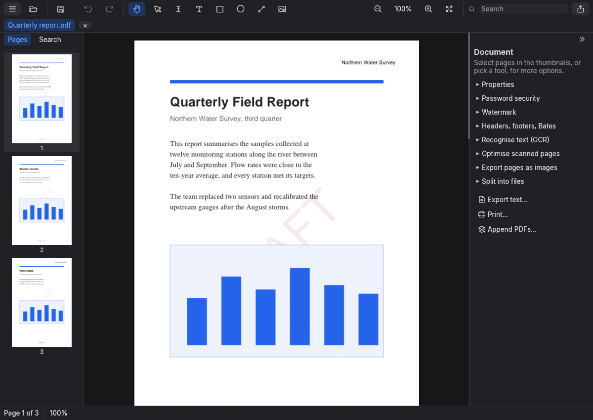

# Using the desktop app

## Opening files

Open PDFs with the Open button, Ctrl+O, or by dropping them on the window. Image files (PNG, JPEG, TIFF) open as a new
document with one page per image. From a terminal, `mpe-gui file.pdf --page 3` opens a file at page 3.

Recently opened PDFs are listed on the start screen and under ☰ > File > Open recent, which also clears the list.
Files that no longer exist are left out. The list holds 10 files and is kept on your computer only, in
`~/.config/mpe/recent.txt` on Linux, `~/Library/Application Support/mpe/recent.txt` on macOS, and
`%APPDATA%\mpe\recent.txt` on Windows.

The start screen also has Make a PDF from images…, which turns photos or scanned pages into a new document.

Each document gets a tab. The tab shows its name, with `*` while it has unsaved changes.

Saving writes a temporary file beside the document and then replaces the document with it, so a save that fails
part way leaves the original as it was. MPE saves by rewriting the whole file, which makes any digital signatures
invalid; when a document is signed, MPE asks first. Save As to a new file keeps the signed original.

## The window

- **Top bar:** the menu (☰), Open, Save, Undo and Redo, the tools, zoom, search, Print, an Export menu (pages as
  images, text), and the theme. On narrow windows the search field and the tools fold into single buttons.
- **Left:** four tabs. Pages shows the thumbnails, Search the search results, and Bookmarks the document's
  outline. Click a bookmark to go to its page; the arrow beside one shows or hides the bookmarks inside it, which
  start shown or hidden as the file asks. Bookmarks that go to another file or a web address are greyed out. They
  can't be edited yet. ☰ > View > Bookmarks, or "Bookmarks" in the command palette, opens this tab. Comments
  lists the document's annotations; see [Comments and markup](#comments-and-markup).
- **Middle:** the pages, scrolling continuously. By default they fit the width between the side panels, and keep
  fitting as you resize the window or open and close the panels. Zooming in or out, actual size, Ctrl+scroll or a
  pinch turns fitting off, and your zoom then stays as it is; the Fit width button (highlighted while fitting is on)
  or Ctrl+0 turns it back on.
- **Right:** the inspector, which shows options for what is selected. On windows narrower than about 960 pixels it
  collapses to a thin rail; click the rail to slide it out. ☰ > View > Inspector shows or hides it.

Ctrl+K opens the command palette, which lists every command. Type to filter, use Up and Down to choose, and press
Enter to run.

## Links

Click a link with the read tool to follow it: the pointer turns into a hand over one, and hovering shows where it
goes. Dragging from a link selects text as usual. With the editing tools, hold Ctrl (Cmd on macOS) and click, so
links don't get in the way of editing.

- A link to another page goes there.
- A link to a web or email address asks first, showing the full address, and then opens it in your browser or
  email program. MPE itself never connects to the network. Links to anything else, such as a file or a program,
  are shown but not opened.
- Links that go to another PDF file are not followed. Links can't be added or edited yet.

## Comments and markup

Annotations (comments, sticky notes, highlights, text boxes, shapes and drawings that other programs added) are
shown on the pages. ☰ > View > Comments, or "Comments" in the command palette, opens the Comments tab, which lists
them page by page, with replies indented under the comment they answer. Each row shows the author and the first
line of the comment; hover over it for the type, date and the whole comment.

- Click a row to go to the annotation and select it, as clicking it on the page does (see
  [Marking text](#marking-text)).
- Right-click a row to delete it, along with any replies. Annotations the file locks can't be deleted. Undo brings
  it back.
- Right-click a row and choose Reply…, or select an annotation and use the Reply box at the bottom of the
  inspector, to answer it. The inspector lists the replies it already has. Replies are saved as standard reply
  comments (`/IRT`) that are not shown on the page or printed, and they carry your name.
- ☰ > Document > Flatten annotations… draws all of them into the pages as they look now and removes them, so they
  can no longer be changed or removed in any reader. Their comment text is dropped. Links and form fields stay,
  and so do file attachments. Undo brings them back.

Some files store annotations without a drawing, leaving each reader to draw them. MPE draws highlights,
underlines, strike-outs, squiggly underlines, notes, text boxes, rectangles, ellipses, lines, polygons and
freehand drawings itself, on screen and when printing. The file isn't changed by this; flattening saves MPE's
drawing into it. Text boxes are drawn in Helvetica, ignoring any rich-text styling.

### Marking text

Select text with the read tool, then click **Highlight** on the bar above it (or right-click > Highlight, or
Ctrl+Shift+H). The small arrow next to it, or right-click > Underline, strike out, colour, has:

- Underline, Strike out and Squiggly underline.
- The highlight colour (yellow, green, blue, pink, orange) and the line colour (red, blue, green, black). The
  colours chosen are remembered between runs.

A selection across pages gets one highlight on each page, all in one undo step. The marks are saved as standard
annotations, so other readers show them and can change or remove them.

Click a mark (or a comment) with the read tool to select it: it is outlined, and the inspector shows who made it
and when, with its colour, opacity and comment, changed with Apply changes. Delete or Backspace removes it, and
Esc lets it go. A drag that starts on a mark still selects the text under it. Hovering over a mark shows its
comment.

New marks are saved with your name, which is the computer's user name until you set it with ☰ > Edit > Your name
for comments…. Leave it empty to save no name.

### Notes and text boxes

The **Annotate** button in the top bar holds the note and text box tools. It shows the one you used last; the small
arrow beside it picks the other. The inspector sets the note colour, or the text box's text size and colour,
background (none at first) and border, before you start.

- **Note:** click on the page. A comment box opens beside the note; type, then click Done (or press Ctrl+Enter).
  Cancel or Esc drops it, and so does Done with nothing typed. Hovering over a note shows its comment. Notes
  show at the same size on screen whatever the zoom, with MPE's own icon in the note's colour (also for notes other
  programs made with a different icon); printed, they keep their own drawing, 20 points across for MPE's.
- **Text box:** drag a box, or click for a default size, then type straight onto the page. Enter starts a new
  line. Click outside the box or press Ctrl+Enter to finish; Esc drops it. Text boxes use Helvetica, so characters
  outside Latin-1 come out as `?`. When you finish, the box grows downward to fit its text, keeping its width; it
  stops at the bottom of the page, and it never shrinks (resize it with the arrow).

A new note or text box is selected with the arrow, so it can be moved straight away. Double-click a note or text
box (with the read tool or the arrow) to change its text. Ctrl+click selects an annotation while an annotate tool
is on. The inspector for a selected text box also changes its text, size, colours, background and border, with Apply changes.

With the arrow, click any annotation to select it, drag it to move it, and drag a handle to resize it. Arrow keys
move it by 1 point, or 10 with Shift. Notes keep their size, and text markup stays on its text, so neither can be
resized, and markup can't be moved. Locked annotations can't be moved.

### Shapes, lines and drawings

The Annotate button's menu also holds the rectangle, ellipse, line and pen tools. What they draw are annotations:
other readers list them as comments, and they can be selected, moved, resized, restyled, commented on and deleted
like notes.

- **Rectangle, ellipse, line:** drag, or click for a default size. Shift keeps squares, circles and lines at
  multiples of 45°. The inspector sets the outline (or line) colour and width, the fill of rectangles and
  ellipses, and an arrowhead at the end of a line, before you start.
- **Pen:** drag to draw; a click makes a dot. Strokes started within 1.5 seconds of the last one, on the same page,
  join the same drawing, so a word or a circle with a tick is one annotation. Each stroke is still its own undo
  step. Points closer together than about a third of a point to the line drawn are dropped, which keeps files
  small. The inspector sets the pen's colour and width.
- **Draw on page (permanent):** with this switched on in the inspector, the rectangle, ellipse and line tools draw
  into the page content as they did before annotations. Those shapes are selected with the arrow as page objects,
  not as comments.

Select a shape, line or drawing (click it with the read tool or the arrow, or Ctrl+click with an annotate tool)
to change its colour, width, fill, arrowhead, opacity and comment in the inspector, then Apply changes. Lines and
drawings are picked by clicking near their strokes, not anywhere in their box.

With the arrow, a selected line has a round handle on each end instead of a box: drag either end to turn the line
or point an arrow somewhere else (Shift keeps it at a multiple of 45° from the other end). Drag the line itself to
move it.

A selected freehand drawing has a round rotate handle above its box; the pointer becomes a circular arrow over it.
Drag it around to turn the drawing about the
middle of its box; the angle shows while you drag, and Shift keeps to steps of 15°. Rectangles, ellipses and text
boxes can't be turned: PDF stores them as upright boxes.

## Filling in forms

Form fields work with the read tool, like links: hovering tints a field and shows its description, and a click
fills it in. With the editing tools, hold Ctrl (Cmd on macOS) and click.

- **Text fields:** a click opens a text box over the field. Enter (in a one-line field) or clicking elsewhere keeps
  what you typed; Esc drops it. Password fields show dots, and their value is not kept in the file.
- **Checkboxes and radio buttons:** a click ticks or chooses.
- **Drop-downs and lists:** a click opens the options. In a list that allows several choices, each click adds or
  removes one; Done closes it. A drop-down you can type in has a text box at the top; Enter keeps the text.
- **Tab and Shift+Tab** move to the next and previous field, top to bottom and page by page. On a checkbox or radio
  button, Space ticks it; on a list, Space or Enter opens it.

Each value you change is one undo step. ☰ > View > Highlight fields tints every field and outlines the required ones
in red. The inspector's Form section shows the field you are in (its name, description and whether it is required),
with Clear field, Highlight fields and Reset form, which puts every field back to its default. Flatten form… (also
in the command palette) makes the fields part of the pages as they look now, so nobody can change the values,
here or in other readers; it asks first, and Undo brings the fields back until you close the document. Read-only fields,
buttons (they run scripts, which MPE doesn't) and signature fields can't be filled in; hovering says why.

MPE draws the filled fields itself, so the values show the same in other readers. Text must be Latin-1 (Western
European) for now; anything else is refused with a message rather than saved wrongly. Fields that have a value but
no drawing of their own are drawn when the file opens. See [Command line](cli.md#forms) for filling forms in
scripts.

## Notices about the document

When a document opens, notices above the pages point out things worth knowing, each with a button where there is
something to do and × to dismiss it. At most two show at a time.

| Notice | Button |
| --- | --- |
| The document was password-protected: saving removes the protection unless you set it again | Password security |
| Its pages are scans without text, so they cannot be searched or copied (checked on the first 20 pages) | Recognise text |
| It is a form made for Adobe Reader (an XFA form), which only Adobe software can show or fill in; MPE shows the placeholder page the file contains, often "Please wait..." | |
| It has a form: click a field to fill it in, or press Tab | Highlight fields |
| It is large (more than 500 pages or 100 MB) | |

The first two go away by themselves once dealt with: after password security is applied, or after text has been
recognised.

## Selecting and the inspector

What you select decides what the inspector, the right-click menu and the floating toolbar offer.

| Selected | Inspector |
| --- | --- |
| Nothing | The document: properties, password security, crop, watermark, headers/footers/Bates, OCR, optimise scanned pages, export pages as images, split into files, and buttons for export text, print and append PDFs |
| Pages (click thumbnails; Shift for a range, Ctrl for one more) | Rotate, delete, extract to a new tab, insert images or a blank page after them, and the crop, watermark, headers/footers, OCR and optimise tools with the pages filled in |
| An object, words, or a tool that adds content | That object's or tool's options |

Menu commands for document and page settings open the matching section of the inspector.

Crop trims margins from each side of the page as it is shown, measured from the full page; the fields start with
the first page's current crop. Remove crop shows the whole page again. Cropping hides content but does not delete
it.

Right-click a page, an object, selected words or a thumbnail for a short menu of what applies there. Right-clicking
selects what is under the pointer first. A selected object or run of words also gets a small floating toolbar with
the same commands.

Drag thumbnails to put pages in a new order. A line shows where they will go. Dragging a selected thumbnail moves all
the selected pages.

Delete removes the selected object or pages. Deleting shows a notice with an Undo button.

## Editing page content

Pick a tool in the top bar. Documents open with the read tool (the text cursor), which selects text, follows links
and fills in forms but never changes page content. The arrow selects objects to edit.

With the arrow:

- Click an object to select it.
- Drag to move it; drag a handle to resize it (Shift keeps the proportions).
- Arrow keys move it by 1 point, or 10 with Shift.
- The inspector shows its position and size, and for text the string, font, size and colour; for shapes the fill,
  outline and width; for images "Replace image".

The other tools add content:

- **Text:** click where the text starts, type, press Enter.
- **Image:** choose a PNG, JPEG or TIFF, then drag a box.
- **Annotate:** sticky notes, text boxes, rectangles, ellipses, lines and the pen, saved as annotations rather
  than page content; see [Notes and text boxes](#notes-and-text-boxes) and
  [Shapes, lines and drawings](#shapes-lines-and-drawings). A rectangle, ellipse or line can still be drawn into
  the page content with "Draw on page (permanent)".

Everything that changes the document can be undone with Ctrl+Z. See [Content editing](content-editing.md) for how
editing works and its limits.

## Copying text

With the read tool, drag to select words in reading order. A drag can start anywhere on the page, such as in the
margin: it starts at the nearest word. Dragging past the top or bottom of the view scrolls it, faster the further
out the pointer is, so a selection can run across pages. Double-click selects one word, triple-click a line, and
Shift+click extends the selection to where you click, on any page. Ctrl+A selects the whole page in view. Esc or
a click clears the selection. Copy with Ctrl+C, ☰ > Edit > Copy text or the floating toolbar: words on a line are
separated by spaces, and lines and pages by line breaks. Recognised (OCR) text can be selected like any other
text.

To print or save just the selection, right-click it and choose Print selected text… or Save selected text… (also
under ☰ > Edit). Both offer two layouts:

- **As it looks (cropped pages):** each page with selected words at its full width, margins included, cut down
  from the top and bottom to the selected lines. Fonts, pictures and layout stay as they are, but anything else
  beside those lines shows too, such as the start of the first line, another column or a picture.
- **Plain text (PDF):** only the selected words, set in 11-point Helvetica on pages the size of the first selected
  page, keeping the line breaks. Characters outside Western European alphabets come out as `?`.

Saving also offers **Text file (.txt)**, the same text that Ctrl+C copies.

Scrolling is left to the mouse wheel, the touchpad, the scroll bars and the keyboard; dragging the page itself
doesn't scroll it (except on a touch screen).

## Keyboard shortcuts

Shortcuts show ⌘ instead of Ctrl on macOS.

| Keys | Action |
| --- | --- |
| Ctrl+O | Open |
| Ctrl+S, Ctrl+Shift+S | Save, Save As |
| Ctrl+W | Close the tab |
| Ctrl+P | Print |
| Ctrl+Z, Ctrl+Y (or Ctrl+Shift+Z) | Undo, redo |
| Ctrl+F | Search |
| Ctrl+K | Command palette |
| Ctrl+= , Ctrl+- | Zoom in, zoom out |
| Ctrl+0, Ctrl+1 | Fit width on or off, actual size |
| Ctrl+scroll, pinch | Zoom |
| PageUp, PageDown, Home, End | Previous, next, first, last page |
| Delete, Backspace | Delete the selected object, comment or mark, or the selected pages |
| Ctrl+Shift+H | Highlight the selected text |
| Arrow keys (Shift for 10 points) | Move the selected object |
| Ctrl+A, Ctrl+C | Select all text on the page, copy it (read tool) |
| Esc | Cancel: clear the selection, or leave a drawing tool |
| Tab, Shift+Tab | Next, previous form field; Space ticks a checkbox or opens a list |

## Look and feel

The app follows the system's light or dark theme. The theme button at the right end of the top bar (a half circle,
sun or moon, for the current choice) chooses System, Light or Dark; so does ☰ > View > Theme. The choice is
remembered between runs, in `settings.txt` in the same folder as the recent-files list, along with the markup
colours and your name for comments. The app uses the Inter font
and Phosphor icons.
