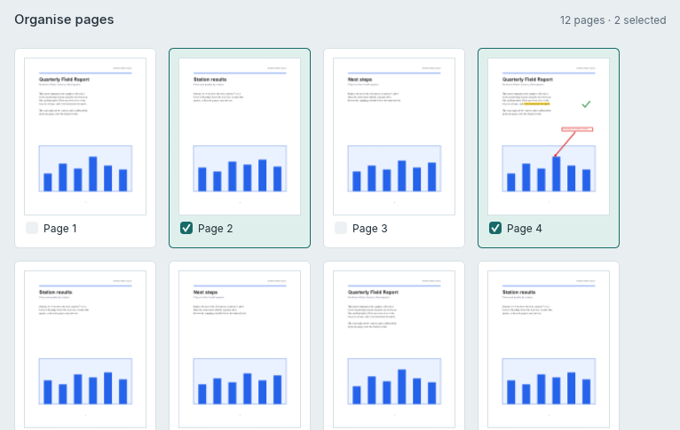

[User guide](README.md) › Everyday tasks

# Organising pages

Put pages in a new order, turn them, add and remove them, take some out into a new document, join documents and
split one into several files. Work in the thumbnails beside the pages, or in Organise, which shows every page at
once. Every change here is one step to undo with Ctrl+Z. Shortcuts are written with Ctrl and Alt; on a Mac, use ⌘
(Command) and ⌥ (Option) instead.

## See every page at once

Choose **Pages > Organise**, or **Organise pages** at the right of the status bar (also ☰ > View > Organise pages
and the command palette). The pages make way for a grid of cards, one for each page, as in a slide sorter: the
page, with a checkbox and its name under it. The heading above the cards counts the pages and those selected,
such as "12 pages · 4 selected", and so does the status bar ("4 of 12 pages selected"). The command band shows
**Pages**, and the Pages view on the left folds away while you organise.

- **Back to reading:** **Page view** in the status bar, or **Pages > Organise** again, shows the pages where you
  were reading. A double-click on a card shows its page instead. Choosing a tool (Edit text, say), Crop, Fit width
  or a page layout goes back to the pages too, at the first page selected.
- **Card size:** the cards have a zoom of their own, from 8% to 60%: Ctrl+scroll, Ctrl+= and Ctrl+-, or the zoom
  in the status bar; Ctrl+1 sets it back to 20%. The size is remembered. Every card is the size of most of the
  document's pages, and a page of another size is fitted inside its card.
- **Long documents:** only the cards in view are drawn, so the grid of a long document opens and scrolls quickly.
- **Bookmarks and search results** still work: the page they go to comes into view in the grid.

## Select pages

In Organise:

- Click a card to select its page, Shift+click another to select the range between them, and Ctrl+click to add a
  page or take it out. A card's checkbox adds its page or takes it out too.
- Drag across an empty part of the grid to select the cards the drag touches; hold Ctrl or Shift to add them to
  the pages already selected.
- Ctrl+A (or **Edit > Select > Select all pages**) selects every page, and Esc lets go of them.

In the page view, click a page's thumbnail in the Pages view on the left, which also goes to that page.
Shift+click selects a range, and Ctrl+click adds or removes one page.

The inspector on the right then says which pages they are, their paper size and which way round they are, and
shows what you can do with them; so does right-clicking a card or a thumbnail. **Pages** in the command band and
☰ > Pages have the same commands, which work on the page you are on when no pages are selected.

### With the keyboard

In Organise the keys go to the grid, unless a button or box has the keyboard: click a card, or press Tab until
the grid has it. Once you use the keys, a ring shows the card they are at. In the page view, click a thumbnail or
Tab to the thumbnails: they take the same keys, in a column, and the page view goes to each page they select.

| Keys | What they do |
| --- | --- |
| Arrow keys | Go to the next card, selecting it: Left and Right a page, Up and Down a row |
| Home, End; PageUp, PageDown | Go to the first or last page; a screen of rows up or down |
| Shift with any of these | Select the pages from where you started to the card reached |
| Ctrl with any of these | Go there without selecting |
| Space (or Ctrl+Space) | Add the card the keys are at to the pages selected, or take it out |
| Enter | Show that page |
| Delete | Delete the selected pages |

## Move pages

- **Drag** a card or a thumbnail to where its page goes: a line shows where it will land, with "Move 1 page" by
  the pointer, and the view scrolls when the pointer nears its top or bottom. A selected card or thumbnail takes
  every selected page with it, in their order; one that isn't selected moves alone. Esc while dragging, or letting
  go of the cards outside the grid, leaves the pages where they were.
- **Alt+Shift with an arrow key** moves the selected pages, as Word moves paragraphs: Left and Right a place
  earlier or later, Up and Down a row up or down (a place, in the thumbnails), and Alt+Shift+Home or
  Alt+Shift+End to the start or the end.
- **Pages > Move** has Earlier, Later, To the start and To the end. ☰ > Pages > Move pages also has Up a row and
  Down a row, and the right-click menu has **Move pages**.

Moved a place or a row, pages that are apart stay apart, each going as far as it can; moved to the start or the
end, they go together. The pages moved stay selected, and each move is one step for Undo.

### Cut and paste pages

To move pages a long way, cut them and paste them where they go:

1. Select the pages and press Ctrl+X (or **Edit > Cut**, or **Cut** in the right-click menu). They stay where
   they are, faint, until you paste them.
2. Choose where they go: in Organise, click between two cards to put the insertion bar there (see
   [Add pages](#add-pages-and-merge-documents)), or select the page to put them after; in the page view, select
   that page's thumbnail, or with nothing selected go to that page.
3. Press Ctrl+V (or **Edit > Paste**, or **Paste** in the right-click menu). The pages move there in their order,
   selected, in one step that Undo takes back.

Esc takes the cut back, and the pages stay selected; Esc again lets go of them. Pasting with no new place chosen
changes nothing, and a message says what to do. The clipboard gets the pages' names, such as "Pages 2, 3 of
report.pdf", not the pages themselves. Pages can't be copied yet (to have them twice), nor pasted into another
document.

## Rotate, delete and extract pages

Select the pages, then use **Pages** in the band (the inspector and the right-click menu have the same commands):

- **Pages > Rotate** turns them a quarter turn clockwise, and **Pages > Rotate ▾ > Rotate counter-clockwise** the
  other way.
- **Pages > Delete** removes them (so does the Delete key). A notice with an Undo button follows.
- **Pages > Extract** opens a copy of them as a new document, to save on its own. The original keeps them.

## Add pages, and merge documents

New pages go after the selected pages, or after the page you are on. In Organise you can choose the place instead:
click between two cards, or before the first one, and the insertion bar shows there. The pages selected are let
go, as in a slide sorter; a click on a card, Esc, or any change to the pages takes the bar away. Pages added in
Organise are selected there. The bar is set with the mouse only: from the keyboard, select the page to add after.

- **A blank page:** **Pages > Insert pages > Insert blank page** (or ☰ > Pages > Insert blank page) inserts one the
  size of the page before it. For another size, select the page to insert after, open **Insert blank page** in the
  inspector, pick Letter, A4 or Legal (or type a width and height in points), and press **Insert after page N**.
- **Pictures:** **Insert images…** (in **Pages > Insert pages**) adds PNG, JPEG or TIFF pictures, one page each
  (see [Scans and OCR](scanning-and-ocr.md#importing-images)).
- **Other PDFs:** **Insert PDF pages…** (in **Pages > Insert pages**, ☰ > Pages or the right-click menu) adds the
  pages of the PDFs you choose there. **Append PDFs…** (in **Pages > Insert pages**, or ☰ > Pages) adds them at the
  end of the document instead. To merge documents, open the first one and append the others.

The files are added in the order chosen, in one step that Ctrl+Z takes back. A password-protected file asks for its
password: **Add pages** adds its pages, **Skip this file** leaves it out and adds the others, and **Cancel** adds
nothing. A file that can't be read adds nothing either, and a message names it.

Inserting or appending PDFs adds the pages only: the bookmarks and named destinations of the files added aren't
carried over, and LimarePDF can't combine forms yet. When a file added has form fields, **Add pages with form
fields?** asks first: **Add pages** draws its fields onto its pages with their answers, as they look now, so they
show everywhere but can no longer be filled in; **Cancel** adds nothing. The document's own fields stay fillable.
If LimarePDF can't draw an answer (text in characters it can't write in a field yet, say), nothing is added, and a
message names the field and the file. Pages from a password-protected file make the whole document count as
protected, so it gets no [recovery copies](gui.md#recovery-copies).

## Split into files

1. Choose **Pages > Split** (or ☰ > Pages > Split into files…). **Split into files** opens in the inspector.
2. Choose **Pages per file** and how many, or **At bookmarks, levels** and how many levels of bookmarks to split at
   (1 is the top level only).
3. Press **Choose folder…** and pick where the files go.
4. Close the tool with the × at the top of the inspector.

Files are numbered after the document, such as `book-001.pdf`; split at bookmarks, they are named after their
bookmark too, such as `book-002 Introduction.pdf`, and the pages before the first bookmark get a file of their
own. Each file is written as soon as its part is made, so a large document split into many files needs little
more memory than the document itself. Splitting doesn't change the document.

If files with the same names are already in the folder, LimarePDF asks once, saying how many, before writing
anything: **Replace** replaces them, **Cancel** writes no files at all.

## Remove blank pages

**Pages > Delete ▾ > Remove blank pages** (or ☰ > Pages > Remove blank pages, or the command palette) deletes every
page that is one even colour, give or take scanner specks, faint show-through or a lone page number, and lists the
pages it removed. Undo brings them back. A document whose pages are all blank is left alone.

## Crop pages

Crop trims margins from the pages as they are shown.

1. Select the pages to crop (or none, for every page), and choose **Pages > Crop** (or ☰ > Pages > Crop pages…).
   **Crop** opens in the inspector. The pages are shown whole, with the part outside each page's crop box dimmed.
2. Drag the crop box's edges or corners on the page, or type the margins. Each drag or number crops all the pages
   in the Pages box at once, and dragging back out undoes a crop.
3. Close Crop with the × at the top of the inspector, or press Esc, to see the pages cropped.

With pages selected, Crop is also in the inspector under **Page properties**: open it there, and fold it again (or
press Esc) to see the pages cropped.

While Crop is open, clicks on the pages only move the crop box. The margin fields start with the first page's
crop, measured from the full page. **Remove crop** shows the whole page again.

Cropping hides content; it doesn't delete it. To remove what is outside the crop box for good, use
[Remove hidden information](redaction.md#removing-hidden-information).

## Number pages your own way

Page labels are the page numbers viewers show, such as i, ii, 1, 2 or A-1, for a document whose front pages are
numbered apart from the rest. They don't change what is printed on the pages.

1. Select the first page to number, or go to it, and choose **Pages > Page labels** (or ☰ > Pages > Page
   labels…). **Page labels** opens in the inspector. (With pages selected, it is also under **Page properties**
   there.)
2. Pick a style, an optional prefix, and the number to start at.
3. Close the tool with the × at the top of the inspector.

The numbering runs to the next labelled range, and each change applies at once. Page labels shows the numbering
the page has now. When a document has labels, the status bar shows the label with the page's place, such as
"Page i (3 of 477)", and the thumbnails, Organise's cards, search results and new bookmarks use the labels. Labels
stay with their pages when pages are deleted or moved.

To have LimarePDF number every document's pages 1, 2, 3 from the first page instead, turn off View > Show > **Use
the document's page labels** (also in ☰ > View). The labels stay in the document, and the status bar still shows
them. The choice is remembered between runs.

## What removed pages leave behind

Pages that are deleted, or left out when extracting or splitting, leave nothing in the saved file: bookmarks,
named destinations, links, the opening view, form fields and tags stop referring to them, so their content isn't
kept.

- A link to such a page goes nowhere, and a form field whose boxes were all on those pages leaves the form.
- Tags with content on those pages lose their alternative text (also when they have content on kept pages too),
  and so do the tags above them.
- An extracted file or a split part keeps the bookmarks to its own pages; a bookmark to another page stays, without
  a destination, only when bookmarks below it stay. Deleting pages keeps every bookmark, without a destination when
  its page went.
- A form nested more than 32 deep can't be followed to its end, so deleting, extracting or splitting stops with a
  message saying why, changing nothing.

## From the command line

`limarepdf-cli` has `extract`, `delete`, `rotate`, `reorder`, `insert-blank`, `remove-blank`, `crop`, `merge`,
`split` and `labels`: see [Pages](cli.md#pages) and [Page labels](cli.md#page-labels) in the command-line
reference.

---

[← Reading and finding](reading-and-finding.md) · [User guide](README.md) · [Comments and markup →](comments-and-markup.md)
