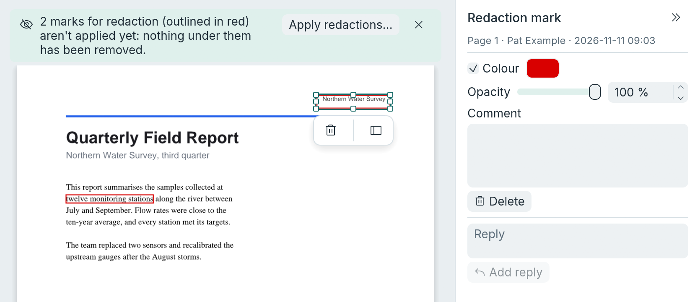

[User guide](README.md) › Everyday tasks

# Redaction

Redaction removes content from a document for good. It doesn't just cover it: the text, pictures and drawings under
a redacted area are taken out of the file, and the area is painted black. Copying, searching, moving the black box
or reading the file's bytes can't bring them back.

It is done in two steps: mark what to remove, then apply the marks. Marks are outlined in red and remove nothing by
themselves, so they can be checked first, by you or by someone else in another app.

## Redact a document

1. Mark what to remove, in any of these ways:
   - **Areas:** click **Protect > Mark redaction** (or choose ☰ > Protect > Mark areas for redaction), then drag a
     box over anything: text, pictures, drawings.
   - **Text:** select it with the read tool, then choose **Protect > Mark redaction ▾ > Mark for redaction** or
     right-click > Mark for redaction (or ☰ > Protect > Mark for redaction).
   - **Every match of a search:** search (Ctrl+F, or **Edit > Find**), then press **Mark all for redaction** in
     Search results (or choose **Protect > Mark redaction ▾ > Mark all search results for redaction**, or ☰ >
     Protect > Mark all search results for redaction).
2. Check the marks. They are listed in the Comments view as "Redaction mark". A mark that isn't quite where it
   should be can be moved or resized (below).
3. Choose **Apply redactions…** in the notice above the pages, or **Protect > Apply redactions…** (or ☰ > Protect >
   Apply redactions…), and confirm.
4. Read the report, then save. Save As (Ctrl+Shift+S) keeps the original as it was.

After marking one area, the Redact tool gives way to the read tool; pin it to mark several areas in a row (see
[Keep tool active](gui.md#keep-tool-active)).

**Changing marks:** select a mark (click it with the read tool, Ctrl+click it with another tool, or click it in the
Comments view), then:

- **Move it:** drag it, or press the arrow keys (Shift with an arrow moves further). A mark over several lines of
  text moves as one, all its lines together; press anywhere inside its outline.
- **Resize it:** drag its handles. A mark of one area (a box you drew, or text on one line) has them; a mark over
  several lines doesn't, as its areas follow the lines: delete it and mark again instead.
- **Delete it** or add a comment, in the inspector or with Delete.

Each move or resize is one step for Undo. Applying removes what is under each mark where it is when you apply, not
where it was first made. A mark locked by the app that made it can't be moved.

**The notice:** while a document has marks, a notice above the pages says how many and has an **Apply
redactions…** button. It comes first, and goes once the marks are applied or deleted; dismissed, it comes back when
another mark is made. It counts marks, so a mark over several lines is one. The Redact tool's pane has the same
button with the count. With no marks, Apply
redactions… is greyed and says why. Saving a document that still has marks asks first, since nothing under them
has been removed.

**Applying** asks first, then removes everything under the marks, paints the areas black and removes the marks. It
then checks that nothing readable is left under them, nor kept another way in the file; if anything is, nothing is
changed and an error says what was found ([the check afterwards](#the-check-afterwards)). A report lists what was
removed from each page, where the removed text can still be found elsewhere in the document (other pages,
bookmarks, comments, form fields, document properties), and the pages where a picture redaction changed is still
drawn as it was outside the marks. Undo brings it all back until
the document is closed, also after saving; the file you saved doesn't hold the removed content, unless you save
again after the Undo.

Marks are standard PDF redaction marks, so marks made in other apps can be applied in LimarePDF, and the other way
round. From the command line, `limarepdf-cli redact` marks, applies, or does both (see
[Redaction](cli.md#redaction)).

To remove information that isn't on any page, such as the author's name or hidden layers, see
[Removing hidden information](#removing-hidden-information).

## What is removed

For each area:

- **Text**, visible or invisible (such as a scanned page's recognised text layer): each character at least a quarter
  under the area is removed (under the areas taken together, where marks overlap: a part two marks share counts
  once). The characters left keep their exact places on the line.
- **Pictures**, scanned pages included: the pixels under the area are blacked out in the picture itself, which is
  then saved again (JPEG pictures as JPEG at about their own quality, black-and-white scans as CCITT, others without
  loss). Pixels only partly under the area are blacked out too. A picture's transparency (soft mask) is cut the same
  way. The blacked-out picture keeps none of its alternate versions (copies some files carry for printing or for
  other screens), since they hold the pixels as they were. A picture shared with other pages or drawn elsewhere on
  the page is copied first, so only the covered copy changes. Pictures LimarePDF can't read (JPEG 2000, JBIG2,
  CMYK JPEG, some unusual formats) are removed whole, and the report counts them.
- **Drawings**: the parts of a drawing mostly under the area are removed. Lines and fills that only cross the
  area's edge (a table border, a coloured background) are kept but cut out of the area. Colour gradients are cut
  out the same way.
- **Grouped content** that several pages share (a logo, a header) is redacted inside, on this page only; other pages
  keep it as it was.
- **Comments, links and form fields** touching the area are removed, with the replies to them. A removed field loses
  its value. A removed comment's drawings (in each of its states) and its text go with it, unless a comment that
  stays uses them too: then they stay for it. All of a page's are checked, also on a page with more than the
  10,000 the app shows, and so are all of its redaction marks when they are applied.
- **Alternative text** that accessibility tools and copying use, on content that lost anything, and on every tag
  above it, however many there are. This includes alternative text kept apart from the content, in the lists of
  named properties that pages, the pages above them (which pass theirs down) and grouped content carry: a name
  holding removed alternative text that nothing left in the document uses is taken off every list it is in, also
  a list other pages share.
- The page's **thumbnail picture** and private application data.

Pictures and grouped content that nothing draws any more are left out of the saved file: also those only other
grouped content, a pattern, a soft mask or a Type 3 font listed, and a redacted group's original, which its
redacted copy replaces where the mark was. A redacted picture's original goes with its soft mask, mask and
alternate versions, and a removed comment with the drawings it showed and the pictures and grouped content they
draw. Every list of resources in the document stops listing them, also a list other pages share and one nothing
draws with; the rest of each list stays as it was.

The marks change only what they cover. Content outside them that still draws an original picture or group that
redaction changed (on another page, in a comment's drawing in any of its states, in a pattern, or in grouped
content drawn with the page's pictures) keeps drawing the original, unchanged, and the report says so for each
such page, once: "An original picture affected by redaction is still drawn elsewhere on page 2 and may retain
the removed content." The same holds for the parts of an original picture still in use (an alternate version
drawn as a picture of its own, a soft mask or mask that a picture still drawn shares) and for a removed comment's
drawing that a comment that stays shows: they stay, and the report names the page that draws them. The original
keeps what the marks covered, since it wasn't marked; redact it there too if that matters. Grouped content that
uses the page's pictures and properties rather than its own keeps what it needs.

If a drawing that may use something removed can't be read, LimarePDF can't tell whether it does, so it removes
nothing for it and the check afterwards fails, changing nothing ("a drawing on page 3 couldn't be read, so
removed content may still be in the file").

Redaction stops with a message, and changes nothing, when it can't follow everything it would have to remove: when
a form field touching an area belongs to a form nested more than 32 deep (fields inside fields), or when the index
that leads from a page to its tags is nested more than 32 deep or too large to search (more than 100,000 parts
looked at), or when the document's drawings lead to one another in too many ways to follow ("the document is too
complex: checking the drawings would take more than 4194304 steps, so nothing was changed"). The largest of 1,080
test files takes about 130,000 of those steps.

## The check afterwards

When it is done, LimarePDF reads the redacted pages again and checks that no text is left under the areas, and decodes
each picture there to check that its pixels under the areas are blacked out. If anything is left, the app changes
nothing and says what it found, and `limarepdf-cli redact` lists it and doesn't write the file.

It then follows everything the saved file would keep, from its start, and checks that nothing redaction removed is
still kept another way. What it removed includes the pages' old content, a redacted picture's or group's original
(a picture's with its soft mask, mask and alternate versions), alternative text taken off (also text stored apart
from what held it, and a property stored apart that held it), removed comments, links and fields (a comment with
what it showed and the text it held), and the pages' thumbnails and private data. The other ways are the tag tree,
private application data and any other part of the file. LimarePDF doesn't cut them, so when one is found the app
changes nothing and says which ("removed content may still be in the file, through the tag tree"), and
`limarepdf-cli redact` doesn't write the file. In a tagged document the tags point at links and comments too, so
removing one they point at refuses this way.

It then looks for the removed text, and the removed alternative text, elsewhere in the document: on any page, in
the alternative text of what each page draws ("alternative text on page 2"), in bookmarks, comments, form fields
and the document's title, author, subject and keywords. Anything it finds is listed as a warning, since redaction
only changes the areas you give it.

## Removing hidden information

A file can carry information that isn't on any page, such as its author's name or the program that made it.

1. Choose **Protect > Remove hidden data** (or ☰ > Protect > Remove hidden information…). It lists what the
   document carries besides its pages, with how many of each, in two groups: what is removed by default (ticked),
   and what is kept by default (often wanted, so not ticked). Kinds the document has none of are greyed out and
   unticked.
2. Tick what to remove, and press **Remove**. A summary follows.
3. Save.

Undo brings it back until you close the document. On the command line: `limarepdf-cli sanitise`.

What is ticked at first:

- **Document information and XMP metadata:** title, author, subject, keywords, the program that made it, and the
  XML metadata in the document and in pictures and other parts.
- **JavaScript and actions that run by themselves:** document scripts, actions run on opening, closing, saving or
  printing, form field scripts (formatting, checking, calculating), and actions that launch programs, send form data,
  import data or open attached files, wherever they are: also when they follow an ordinary action, in a list
  written into it or stored apart (a link that opens a web page and then runs a script loses only the script).
  Ordinary links to pages and web addresses stay. A form with both XFA and ordinary fields loses its XFA part (it
  holds scripts); a form made only for Adobe Reader (XFA only) keeps it.
- **Attached files:** files attached to the document or to comments.
- **Hidden layers and their content:** the content of layers that are switched off is deleted, and so is content
  a layer rule hides, wherever it is drawn: on the pages, in forms drawn inside forms (up to 32 deep), in comments'
  and fields' drawings, in patterns, soft masks and Type 3 fonts. A layer rule combines layers ("shown when layer A
  is on and layer B is off"), and rules can sit inside rules; LimarePDF reads them as other PDF readers do, so
  what a rule hides goes even when every layer it names is on. A picture only hidden content drew is left out of
  the saved file, also when it was listed by a form inside a form. Layers that are off leave the layer list;
  layers that are shown stay. A rule that stays but named a removed layer is rewritten without it, so switching
  the layers that stay still shows and hides what it did. What shows doesn't change: a colour, position or clip
  hidden content sets still applies to what is drawn after it, and hidden text is replaced by a gap as wide, so
  text after it on the line stays where it was. The number shown is the layers switched off plus the rules that
  hide content though every layer they name is on. If some drawing or layer rule can't be read (a rule with an
  operator LimarePDF doesn't know, or containing itself), or is nested deeper, LimarePDF can't tell whether it
  holds hidden content, so the command stops with a message saying what, and changes nothing; a rule that can't
  be read counts in the number, so Remove can say why. It stops in the same way for a drawing without resources
  of its own that is used in places giving its layers or fonts different meanings (hidden in one, shown in
  another), as its hidden content can't be taken out of one place only; and where removing hidden content would
  change what shows: hidden text that clips what comes after it, hidden text whose width LimarePDF can't work out
  (its font is set where the drawing is used) with visible text after it on the same line, or a shape begun in a
  hidden layer and painted outside it, or when the document's drawings are too complex to follow (as for
  redaction). Leave hidden layers out to remove the rest. Compressed data is checked to its end: if it is cut off
  or damaged part way, the command stops in the same way ("Part of this document is damaged..."). Data that is
  complete but whose checksum at the end is wrong is read in full, as other PDF readers read it, and the result
  says so.
- **Thumbnails and private application data:** page thumbnail pictures, data programs keep for themselves (such
  as Illustrator's, and LimarePDF's note of the paragraphs whose edges or alignment you set, with the date the
  page was last changed), and web capture information. Afterwards those paragraphs' edges are worked out from
  their lines again.

Not ticked at first, as they are often wanted:

- **Comments and markup** (redaction marks stay), every one, also on a page with more than the 10,000 the app
  shows. Attached files are removed in the same way.
- **Form field values:** every field's value is cleared for good, read-only fields included, along with default
  values (so Reset form brings nothing back), values a field takes from a parent field, rich text and the drawings
  that showed them; checkboxes and radio buttons are switched off. Fields LimarePDF can't draw lose their drawing,
  and readers draw them empty. Signature fields are left alone. The fields themselves, and their choices, stay. A
  form nested more than 32 deep (fields inside fields, form boxes included, also boxes the form's list of fields
  leaves out) can't be followed to its end, so the command stops with a message and changes nothing; leave form
  values out to remove the rest.
- **Bookmarks.**
- **Content outside the visible page area:** what lies outside each page's crop box is redacted and the page becomes
  the size it is shown at. If redaction's check afterwards finds something it couldn't remove for certain (such
  as a drawing the document's tag tree still points at), the command stops with a message saying what, and
  changes nothing; leave content outside the visible page area out to remove the rest. The pages are still
  counted in the list, since the check is made only when removing. When a picture that was
  cut is still drawn, unchanged, elsewhere on the page, the summary says so, as for redaction.

Nothing else is kept: saving rewrites the whole file, leaving out everything no longer used, and earlier versions
of the file aren't kept in it.

## Limits

- The width of the gap shows how long the removed text was.
- Fonts embedded in the file keep the shapes of the letters they contain, including removed ones (not the text
  itself).
- Text whose characters can't be placed for certain is removed a whole piece at a time when any of it is under the
  area: text in fonts whose character map, or its code ranges, can't be read (some Asian-language encodings),
  text in fonts whose character map other readers split into characters in different ways (a code that also
  starts a longer one, say), and text holding a code its font's character map leaves out. LimarePDF draws such a
  code as one byte, so the characters after it can show elsewhere than other readers put them; the piece goes when
  the area covers it in either place.
- Text set in vertical writing, and text and pictures inside tiling patterns, aren't redacted.
- A picture drawn at an angle (not a quarter turn) is blacked out over a rectangle in the picture that holds the
  whole area, so a little more than the area can go black.
- Saving a JPEG picture again loses a little quality across the whole picture.
- A blacked-out picture keeps the picture's own XMP metadata, which can hold a title, a caption or a small preview
  of the picture as it was; redaction doesn't check it. **Remove hidden information** removes it (Document
  information and XMP metadata).
- The removed text can still be in bookmarks, comments, file attachments or metadata; the check warns about the
  places it can search.
- Redaction marks can't be moved or resized; delete one and mark again.
- Removing hidden layers: any drawing whose compressed (Flate) data is cut off or damaged part way stops the
  command, even where other readers would show what comes before the damage, since what follows it can't be
  checked. A file with such damage can have its other kinds of hidden information removed with hidden layers left
  out. Data in the older compressions (LZW, run length) is checked only as far as lopdf reads it: if it decodes to
  nothing it stops the command. In a file with layers where nothing is hidden (no layer is off, and no rule
  LimarePDF can read hides anything), a damaged drawing doesn't stop it, as there's nothing to remove; a layer
  rule written inside that damaged drawing would be missed.
- Removing hidden layers stops, changing nothing, at a layer rule nested more than 32 deep, or when checking the
  document's rules would take more than about a million steps (each layer named and each and, or and not is a
  step; a rule used in many places is checked once).

## How this was tested

Redaction and removing hidden information are tested on made-up files for each case, on public PDFs and on a
scanned page. The saved file itself is searched for anything removed, and other readers (poppler and Ghostscript)
are used to confirm it's gone. The Redact tool was used by hand on Linux; the Remove hidden information dialog
wasn't clicked through. Marks made by LimarePDF haven't yet been opened in Acrobat or other apps, nor marks made
by them applied in LimarePDF. The full record is in
[Testing](developer/testing.md#redaction-and-hidden-information).

---

[← Password protection](security.md) · [User guide](README.md) · [Digital signatures →](signatures.md)
