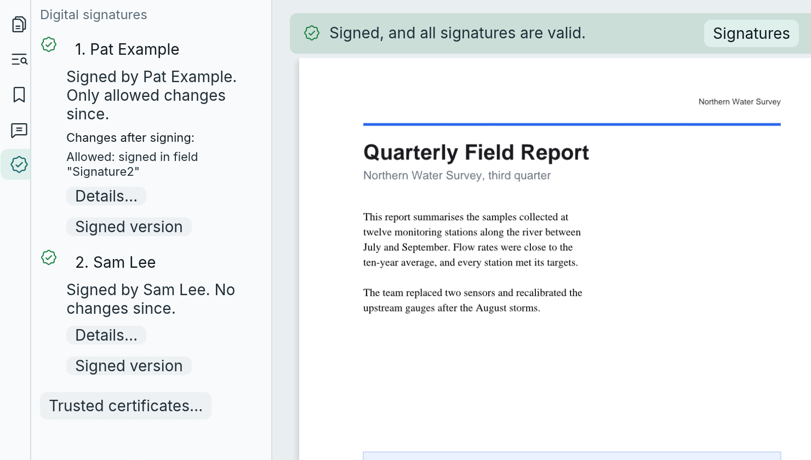

[User guide](README.md) › Everyday tasks

# Digital signatures

Check the digital signatures on a PDF you receive, see what changed after each one, and sign documents with your
own digital ID. A valid signature proves that what it signed hasn't changed since the signer's key signed it; whose
key that is, you confirm once, by trusting the signer. Checking needs nothing: no network, no account, no
certificates installed. LimarePDF never connects anywhere to check a signature. It follows Adobe Acrobat's rules so
signed documents can go back and forth between them; round trips with Acrobat itself are still to be tested (see
[Compatibility](#compatibility)). It trusts only the signers and authorities you add, and can't sign
password-protected documents (see [Limitations](#limitations)).

## Check a signed document

1. Open it. LimarePDF checks its signatures by itself, and a banner above the pages gives the result: green
   (valid, and you trust every signer), amber (nothing broken, but LimarePDF can't confirm who signed, or there are
   warnings), grey (a signature can't be checked) or red (broken, or changed in ways a signer didn't allow).
2. Press **Signatures** in the banner to see each signature, what changed after it, and **Details…**.
3. To see a signer as trusted, check their certificate's fingerprint with them, then use **Trust this signer…** in
   Details (see [Trusting signers](#trusting-signers)).



The **Digital signatures** view (also its icon on the left, or **Forms and sign > Digital signature > Signatures
in this document**) lists the signatures in the order they were made: who made each one (click to go to it on the
page), its result in a sentence, the changes made after it (those the signer didn't allow in red) and any
warnings. **Details…** shows everything about a signature: who signed and who issued their certificate, when, the
reason they gave, the certificate's SHA-256 fingerprint and every change after signing. **Signed version** opens
the document exactly as it was when that signature was made, without anything added later, in a new tab: open it
to see what the signer saw.

The banner and the view describe the file as opened or last saved: after you change the document, the view says
that your unsaved changes aren't checked, and saving checks the saved file again.

What each colour, result, warning and change means: [Digital signatures in
depth](signatures-in-depth.md#checking-a-signed-pdf).

## Sign with a digital ID

1. The first time, make a digital ID: **Forms and sign > Digital signature > Digital IDs…** (or ☰ > Document >
   Digital signatures > Digital IDs…), then **Create…** (or **Import…** one you have). See
   [Digital IDs](#digital-ids).
2. Choose **Forms and sign > Digital signature > Sign with digital ID…** (or ☰ > Document > Digital signatures >
   Sign with digital ID…).
3. Click an empty signature field, or drag a box where the signature goes.
4. Pick your digital ID, type its password, and press **Sign…**.
5. Choose where to save the signed copy. It opens in place of the document.

The details, and certifying, are in [Signing](#signing).

## What a digital signature is and isn't

A digital signature proves that the signed bytes of a document haven't changed since a particular key signed them.
It doesn't by itself say who owns that key: the signature carries a certificate naming someone, and anyone can make
a certificate with any name. Whether to believe the name is a separate question, called trust.

It is not the same as [fill and sign](fill-and-sign.md), which puts a picture of your signature on the
page. Anyone can copy a picture; a digital signature breaks if the bytes it signed are changed. A signed document can
still be changed afterwards without breaking it, as long as the changes are saved after the signed bytes (which
LimarePDF does): each one is then listed with the signature, and judged by whether the signer allowed it (see
[Changes after signing](signatures-in-depth.md#changes-after-signing)).

## Trusting signers

Anyone can make a digital ID with any name on it, so a valid signature alone doesn't say who signed. LimarePDF shows
a signer as trusted only when your **trust list** vouches for them, as Acrobat does from its trusted certificates:
until then their valid signatures show amber, saying LimarePDF can't confirm who they are. You can trust a signer,
or a certificate authority, which trusts every signer it issued a certificate to (everyone at an organisation, say).

To trust a signer:

1. Open a document they signed, press **Signatures** in the banner, and press **Details…** under their signature.
2. Press **Trust this signer…**. It shows the signer's certificate with its SHA-256 fingerprint.
3. Compare the fingerprint with the signer in a way you trust: by phone, in person or on a website you trust. A
   certificate taken from a signed PDF is only as trustworthy as that comparison: whoever made the PDF chose the
   certificate.
4. Type the name to keep it under in your list, and press **Trust**.

Every open document is judged again as soon as the list changes.

- **An authority:** **Trust an authority…** in Details does the same for an authority from the certificates the
  signature carries (choose one when there are several). Trust the most specific authority that covers the signers
  you mean.
- **A certificate someone sent you** (`.cer`, `.crt`, `.pem`, or `.p7c` as Acrobat exports it): choose **Forms and
  sign > Digital signature > Trusted certificates…** (also ☰ > Document > Digital signatures > Trusted
  certificates…, and at the bottom of the Digital signatures view), then **Add certificate file…**. It is added as
  a signer unless you choose certificate authority, which only an authority's certificate allows.
- **Stop trusting:** in **Trusted certificates…**, press **Remove…** beside the entry, then **Stop trusting**.

Trust settings affect LimarePDF only: trusting someone in LimarePDF doesn't change Acrobat or any other program.

**For others to trust your signatures**, they need your certificate: export it ([Exporting a digital
ID](#exporting-a-digital-id), Certificate only), send it to them, and tell them its SHA-256 fingerprint another way,
such as by phone.

What the Trust line says, and what LimarePDF checks before trusting: [Trusting signers in
depth](signatures-in-depth.md#trusting-signers-in-detail).

## Digital IDs

A digital ID is what you sign with: a private key, which stays secret, and a certificate naming you, which goes
into every signature you make. LimarePDF keeps your IDs, each protected by its own password. You make, import,
export and remove them in the **Digital IDs** window: **Forms and sign > Digital signature > Digital IDs…** (or ☰ >
Document > Digital signatures > Digital IDs…). Pick an ID there to see its certificate, key, validity and SHA-256
fingerprint.

### Making a digital ID

1. In the Digital IDs window, press **Create…**.
2. Type your **Name**, as signatures will show it, and if you like your **Organisation** and **Email**.
3. Type a **Password** twice: at least 8 characters, and a long one is better. LimarePDF can't recover it, and
   without it the ID can't sign.
4. Press **Create**. Making the ID takes a few seconds.

LimarePDF makes a self-signed ID, like the ones Acrobat makes: an RSA key (3072-bit) and a certificate valid for five
years. "Self-signed" means nobody vouches for the name in it: your signatures show as *not confirmed* to others
until they trust your certificate (see [Trusting signers](#trusting-signers)). Keep a copy of the ID (export it with
its key): if this computer is lost, so is the ID.

### Importing a digital ID

1. In the Digital IDs window, press **Import…** and choose the `.p12` or `.pfx` file (from Acrobat, Windows, macOS
   or a certificate authority).
2. Type the file's password, and press **Import**.

LimarePDF keeps its own copy, protected by the same password; the file you imported is left as it was, so keep it
safe or delete it. LimarePDF refuses a file it couldn't sign with, and says why
([the reasons](signatures-in-depth.md#importing-a-digital-id)). An expired ID is imported, so you can keep and export
it, but LimarePDF won't sign with it. Add ID files this way, not by copying them into LimarePDF's settings folder.

### Exporting a digital ID

1. In the Digital IDs window, pick the ID and press **Export…**.
2. Choose what to export:
   - **Certificate only (.cer)**: no key, safe to share, for others to trust your signatures. The window shows its
     SHA-256 fingerprint, to tell them another way.
   - **With its key (.p12)**: a backup, or to sign in another app. Type the ID's password; the file is protected
     with the same one, or tick **Protect the file with a new password**. Anyone with that file and its password
     can sign as you.
3. Press **Export…** and choose where to save it.

### Removing a digital ID

In the Digital IDs window, pick the ID, press **Remove…**, then **Remove for good**. This deletes the ID's file: it
can't be undone, and the ID can't sign again unless you have an exported copy. Signatures already made with it stay
valid.

**Make default** chooses the ID signing starts with. The ID made, imported or signed with last is the default.

More about the Digital IDs window, the files LimarePDF reads and writes, and where IDs are kept: [Digital IDs in
depth](signatures-in-depth.md#digital-ids-in-detail).

## Signing

Signing needs a [digital ID](#digital-ids) and its password. The ID must be valid on the day you sign, by your
computer's clock, and the document must not be encrypted, nor set to get a password when saved (the signed file
would be written without it).

1. Choose **Forms and sign > Digital signature > Sign with digital ID…** (or ☰ > Document > Digital signatures >
   Sign with digital ID…), or **Certify…** in the same menus to [certify](#certifying) the document (only
   before anyone has signed it).
2. Click an empty signature field on the page, or drag a box where the signature goes (at least 12 points each
   way). The pane also lists the document's empty signature fields to pick from. Esc, or another tool, stops.
3. In the window, pick the digital ID (the default is picked; expired IDs can't sign), type its password (leave
   it empty for an imported ID that has none), and optionally a reason and a location. **Show my saved signature
   beside the text** uses the first signature in your fill-and-sign list for the left part of the look; without
   one, your name is written in handwriting. **Digital IDs…** opens the Digital IDs window, to make or import one.
4. **Sign…** (or **Certify…**) asks where to save the signed document, suggesting `NAME-signed.pdf` beside the
   original, then signs in the background. The signed document opens in place of the one you signed, and is checked
   as any signed document is. If the document changes while it is being signed (an edit, a password set, text
   being typed), it stays open as it is, and the signed copy opens in a new tab.

A missing or wrong password is said under the password, where the keyboard goes; any other problem is said at the
end of the window. The password is cleared once used, and never saved, so after a failure you type it again; the
reason, location and other choices stay.

What you sign is the document as it is in LimarePDF, with every change made since you opened it. When those changes
would show on earlier signatures as not allowed (a page turned or edited, for example), LimarePDF stops before
writing anything and says which earlier signatures would report which changes; **Sign anyway** goes ahead after you
type the password again. A signature can't be moved or resized afterwards (sign again in a new copy instead).

### Certifying

Certifying is the author's signature, which also says what others may still do. Choose **Certify…**, and in the
window pick from the **Others may** list: **Make no changes**, **Fill in forms and sign**, or **Fill in forms, sign
and add comments**. A document can be certified only before anyone signs it, as in Acrobat. After a certification,
LimarePDF signs only in the signature fields the document already has, and not at all when it allows no changes.

What LimarePDF writes when it signs, and the document's rules it follows: [Signing in
depth](signatures-in-depth.md#signing-in-detail).

## Saving a signed document

**Save** and **Save as** keep a signed document's signatures. LimarePDF adds your changes after what was signed, the
way Acrobat saves signed files, so each signature stays valid for the version it signed and lists your changes: a
comment or a filled-in field shows as an allowed change.

- **When the signatures don't allow your changes** (a page edited, turned, added or deleted, say), LimarePDF asks
  first, naming each signer and what their signature will report. **Save anyway** writes it, and every reader shows
  that the document was changed afterwards in ways the signers didn't allow.
- **When LimarePDF can't add your changes after what was signed** (after redacting or removing hidden information,
  for an encrypted document or one you set a password for, or a damaged one, for example), it says why and asks
  before writing the whole file instead (*Break the signatures?*), which breaks every signature in the saved copy.

Either way, Save as a new file keeps the signed original as it is.

**What you delete stays in the signed version.** A comment you delete, a page you remove, a value you overwrite:
the version that was signed still holds it, and anyone with the file can open that version. To remove something for
good, use Redact or Remove hidden information, which write the whole file and break the signatures.

Every case, and the command line's flags: [Saving a signed document in
depth](signatures-in-depth.md#saving-a-signed-document-in-detail).

## From the command line

`limarepdf-cli` does all of this too:

```
limarepdf-cli verify contract.pdf                    # check every signature
limarepdf-cli trust add contract.pdf --signature 1   # trust signature 1's signer: compare the fingerprint first
limarepdf-cli id create --name "Jane Doe"            # make a digital ID
limarepdf-cli sign form.pdf -o form-signed.pdf --field Approver
```

See [Digital signatures](cli.md#digital-signatures) in the command-line reference, and
[Digital signatures in depth](signatures-in-depth.md) for each command's details.

## Compatibility

- **Checking** agrees with poppler's `pdfsig` and OpenSSL on third-party signed files with known results and on
  LimarePDF's own signatures.
- **Adobe Acrobat:** a document signed in LimarePDF with a self-signed ID shows in Acrobat Reader on Windows as
  signed with a self-signed certificate, with the signer's details in their places. The other round trips with
  Acrobat haven't been run yet.

The full list: [Compatibility](signatures-in-depth.md#compatibility).

## Limitations

The ones you are most likely to meet:

- Trust comes from your own list only. LimarePDF doesn't include Adobe's list of trusted authorities (AATL) or the
  EU's trusted lists, so a signature from a commercial or government authority that Acrobat shows as trusted is
  *not confirmed* in LimarePDF until you trust its authority.
- Revocation (whether a certificate was withdrawn) isn't checked: LimarePDF makes no network connections.
- Changes after signing are judged strictly where Acrobat's exact behaviour isn't documented, so LimarePDF may
  refuse changes Acrobat accepts. A refused change is listed by name, so you can judge it.
- Signatures LimarePDF makes carry no timestamp from a timestamp authority, so their signing time is your
  computer's claim.
- Encrypted (password-protected) documents can't be signed.
- Digital IDs on smart cards and USB tokens, and those kept in the Windows certificate store or the macOS Keychain,
  can't be used directly: export them as a `.p12` or `.pfx` file (if the card or store allows it) and import that.
- A forgotten password can't be recovered, by LimarePDF or anyone: make a new ID, and give the people who trusted the
  old one your new certificate.

Every limit: [Limitations](signatures-in-depth.md#limitations).

## More detail

[Digital signatures in depth](signatures-in-depth.md) is the reference: checking in detail, what LimarePDF checks
before trusting, what each result, warning and NOT TRUSTED reason means, which changes after signing are allowed,
what signing writes, every limit, security notes and troubleshooting.

---

[← Redaction](redaction.md) · [User guide](README.md) · [The desktop app →](gui.md)
